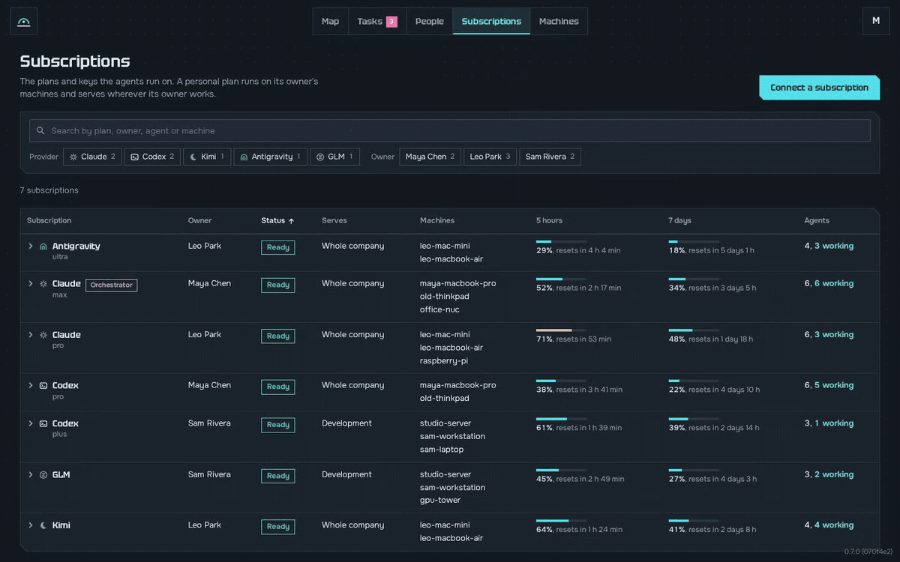
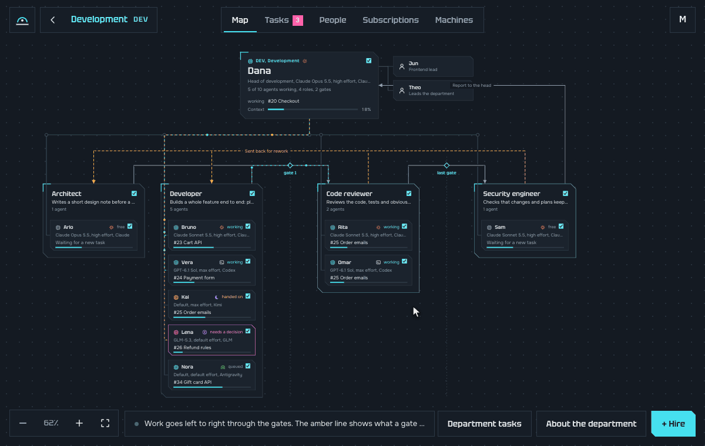
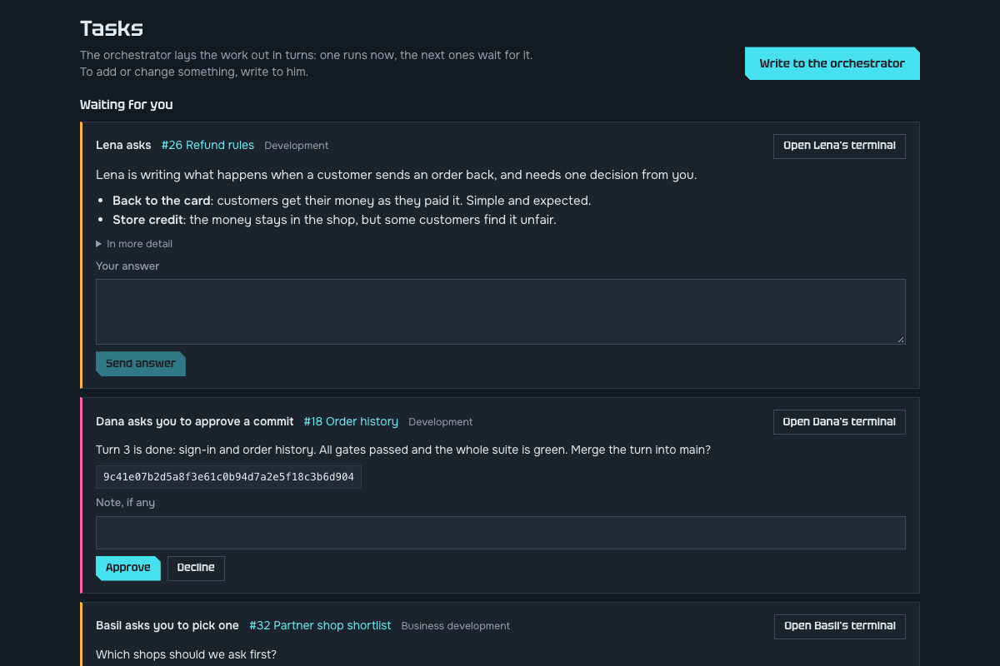
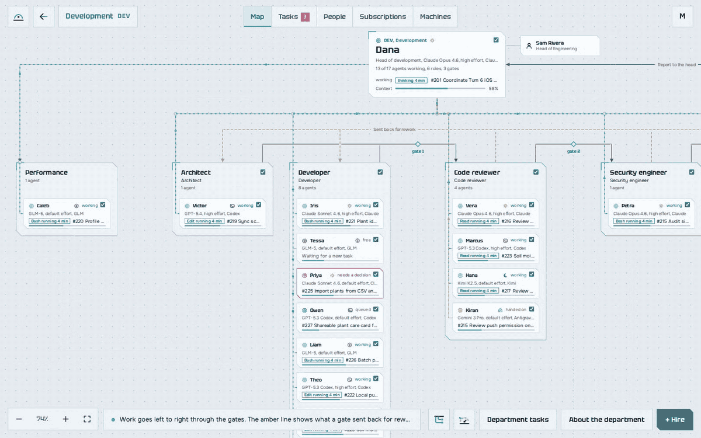
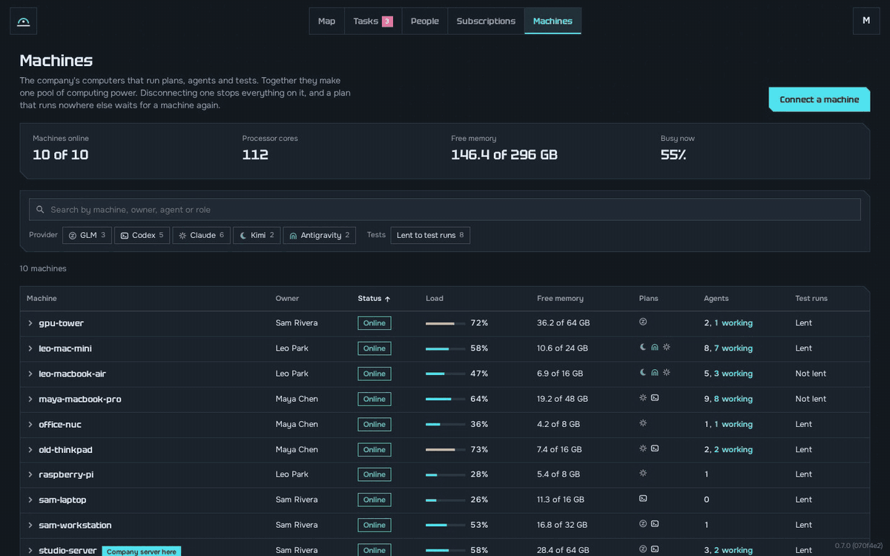
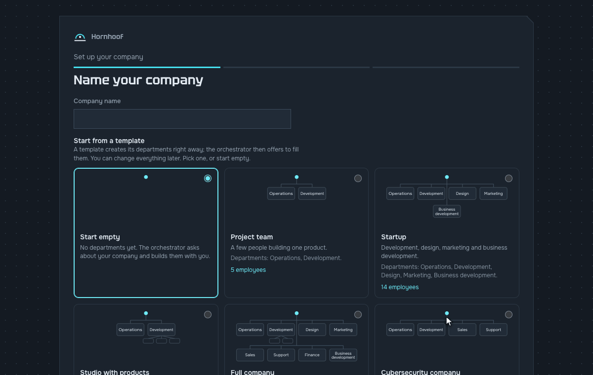

# What people do with Hornhoof

Real ways to use Hornhoof, from everyday work with AI plans to a home run like a small company. Each one says what to set up. The [README](README.md) has the install.

The pictures show Moonfern, a made-up company. Its people, plans and work are invented for the demo.

## Work

### Many AI plans working as one team

Say you pay for Claude, ChatGPT and Kimi. Usually you work in one of them while the others wait. Connect all of them under Subscriptions, on your own computer. When the orchestrator staffs a department, each employee gets a plan and a model, so developers on Claude, on Codex and on Kimi take different tasks of the same job at the same time. The employee's card shows its plan and model, and you can change both.

Work written on one maker's model is checked by reviewers on the others, one of each, at the same time. Each of them catches mistakes the others miss, and the work passes only when all of them agree.

A plan that reaches its limit does not stop the job. Its task goes to an employee of the same role on another maker's plan that still has room, or waits until the limit resets and then goes on by itself. Next to each plan's limits, "Tasks may use" sets how much of every limit window the tasks may spend, from 50 to 90 percent, so some is always left for you.



### Too many windows

Instead of a dozen chats you have one company. You write to the orchestrator once, he turns it into a turn of tasks, and each department's head gives them out. Every employee works in its own terminal, which you can open, watch live and type into. When an agent needs you, its question, a change to approve or a task it is stuck on waits for you at the top of Tasks, so you answer everything in one place.





### A development team that checks its own work

Give the Development department a git repository and a token for it. The head keeps connected work with one developer and splits off only independent parts, with a short design note from an architect first when the feature is new or big. Each piece gets only the checks it needs: none for research and docs, one review for code, and a security review when the change touches sign-in, access or secrets. The whole turn is tested once at the end, on its own branch. Nothing reaches the main branch until you approve the exact commit.



### Every computer you have helps

Connect your work laptop, an old one and a server, each with one command from the Machines tab. A computer does not need a plan of its own to help. The Machines tab shows them as one pool: how many cores and how much free memory they have together, and how busy each one is.

When an agent runs the tests, Hornhoof sends them to whichever machine is free and splits a big test suite across several machines at once. Other heavy work, like a build or a report, goes out the same way, and the results come back to the task. A busy machine gets no new work. Untick "Lend to test runs" on a machine to keep it for yourself.



### Building something with friends

Invite each friend with a link from People. Everyone connects their own plan on their own computer, so their agents work for the shared company while their sign-in never leaves their machine. Give each person the departments they work in, and they see only those. Someone who works across several departments shows up next to the CEO on the map as a deputy.

### Several products

Put a product under a department for each thing you build, each with its own git repository, so each product's agents work in their own code. The Studio template sets this up: one development department with several products under it.

### Open it from anywhere

During setup, Hornhoof offers your company a link like `https://your-name.hornhoof.org`. Open it from your phone or any computer, with your own sign-in. Nothing has to be opened on your router, and you can change or remove the link later under Share access. Or keep Hornhoof on your own network only.

### Several companies on one computer

Run two or three companies side by side, each at its own address with its own people, plans and data. Give the second one a name when you install it:

```sh
curl -fsSL https://raw.githubusercontent.com/Invariant0x/hornhoof/main/scripts/install.sh | bash -s -- server --name acme
```

## Templates to start from

Setup offers these. A template creates its departments and their employees right away, and they start working as soon as you connect a subscription. You can change everything later.



| Template | What you get |
| --- | --- |
| Start empty | No departments yet. The orchestrator asks about your company and builds them with you. |
| Project team | A few people building one product: operations and development. |
| Startup | Development, design, marketing and business development. |
| Studio with products | One development department with several products under it. |
| Full company | Every department, with products under development. |
| Cybersecurity company | Development with security and a red team, plus operations, sales and support. |
| Open-source project | Development and support for a project people build together. |
| Agency | Sales, delivery through operations, and support for client work. |
| Research lab | Development with an architect and documentation, for research work. |
| Home | Home devices and network, and the household. |

## Home

### A home full of devices

Pick the Home template. It gives you a department that looks after the Wi-Fi, the router, the smart home and updates, and a household department for shopping lists, supplies, bills, chores and the family calendar. It works best with a few home computers connected, so the work has somewhere to run. Anything that acts on a real device, buys something or pays for it waits for a person to say yes.

### Phones, next

Phones will join the pool too. An old Android phone on a charger will run work as a machine of its own, and any device with a browser, an iPhone too, will be able to lend itself by keeping a page open.
