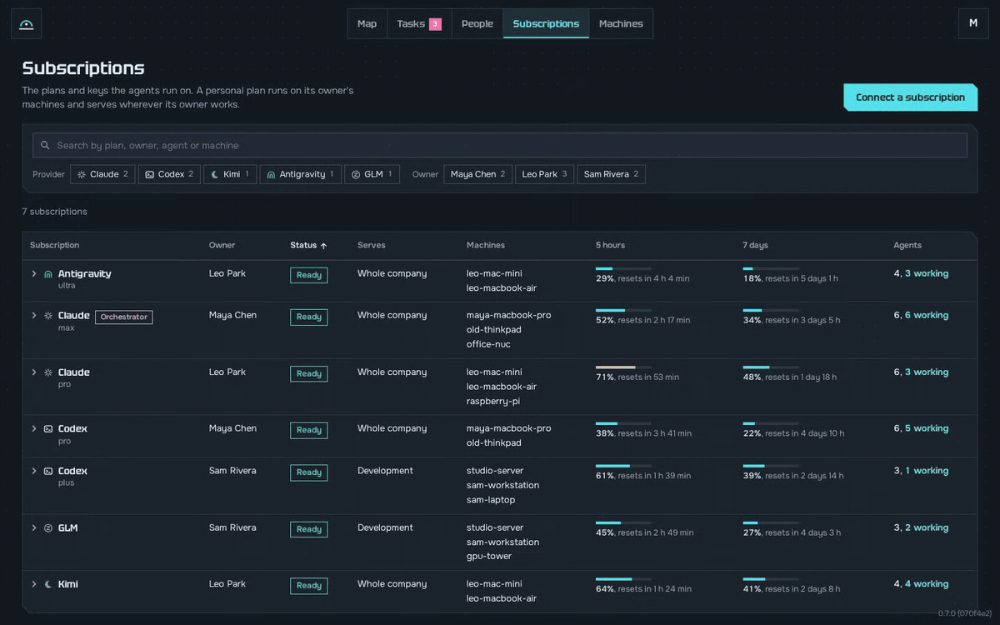
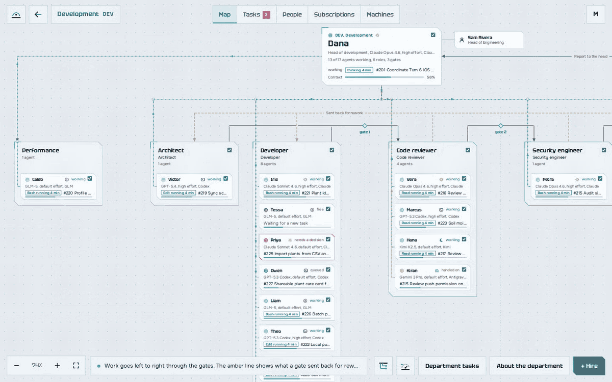
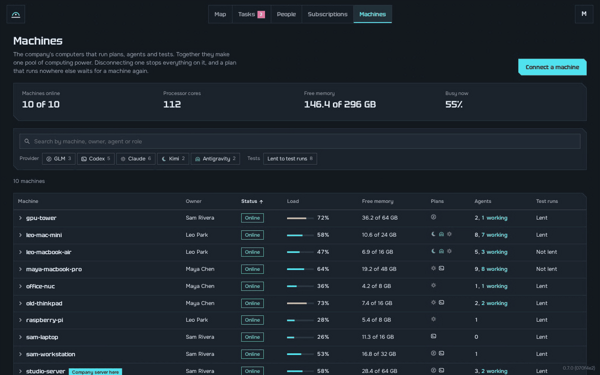
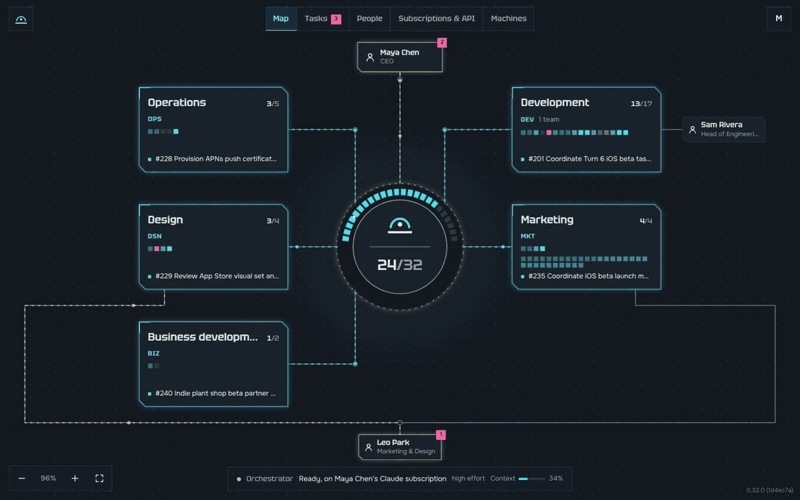
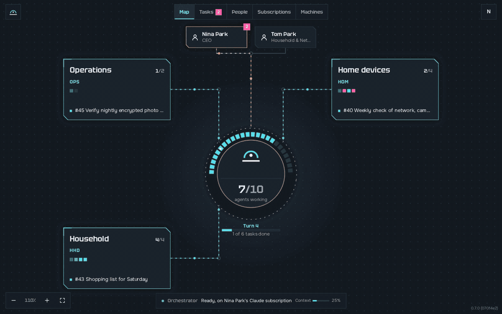
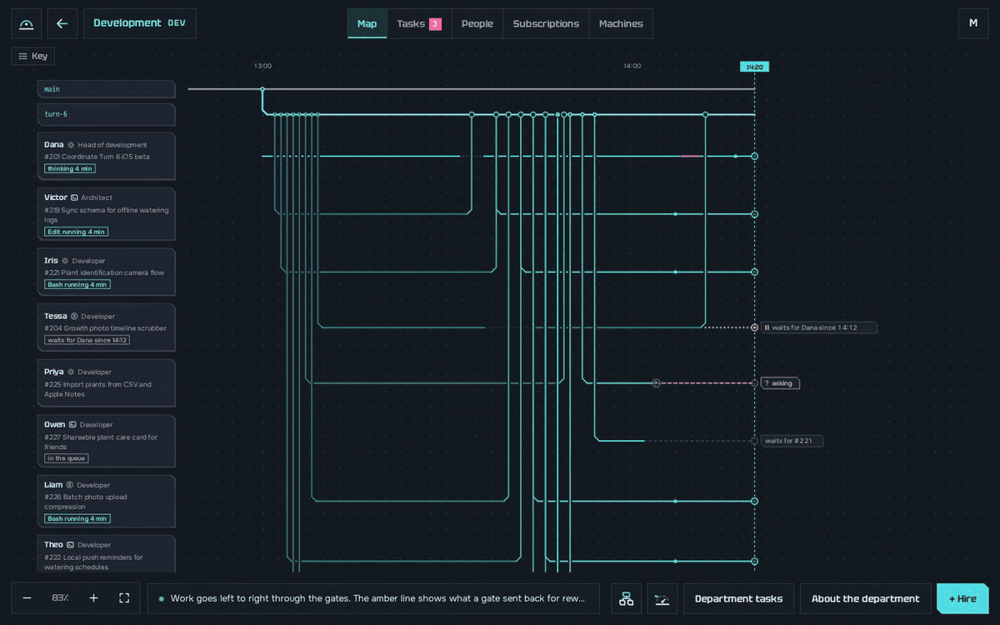
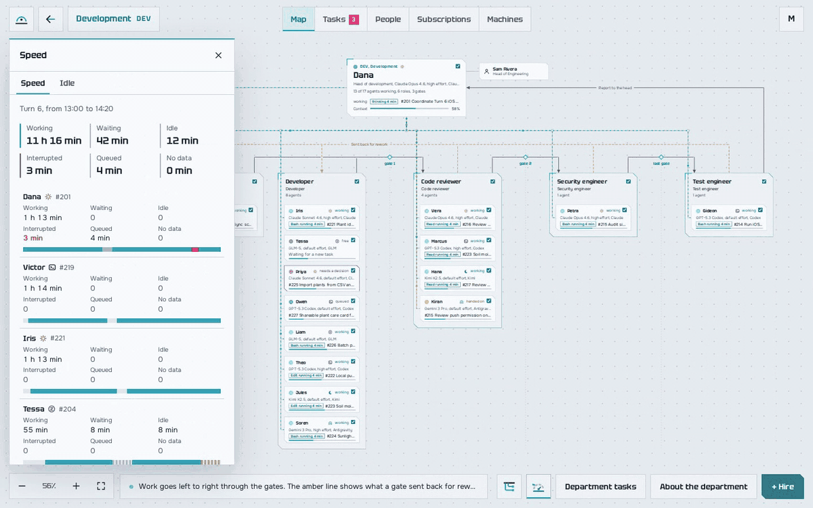
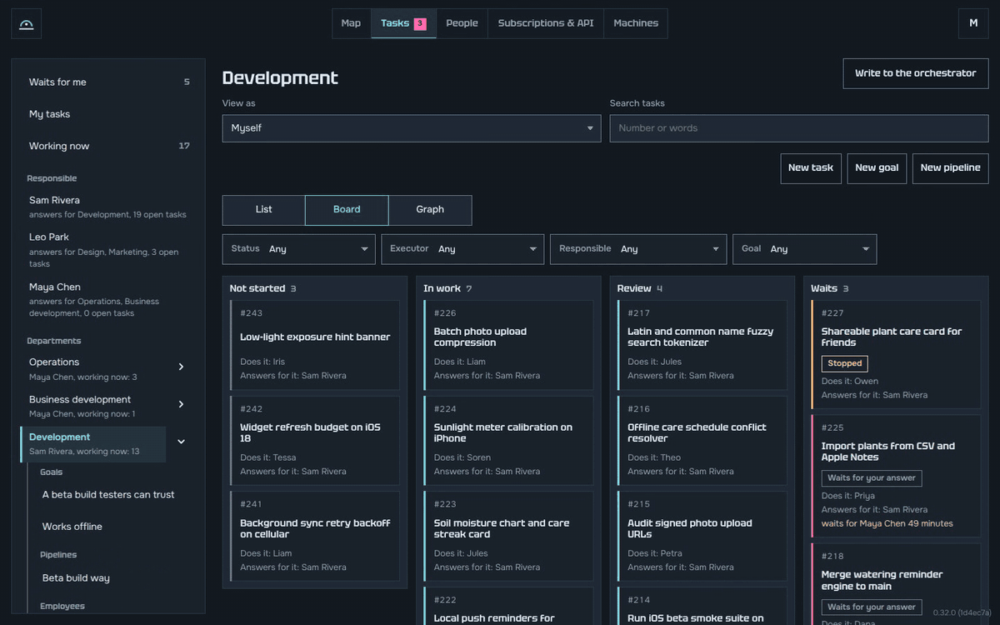
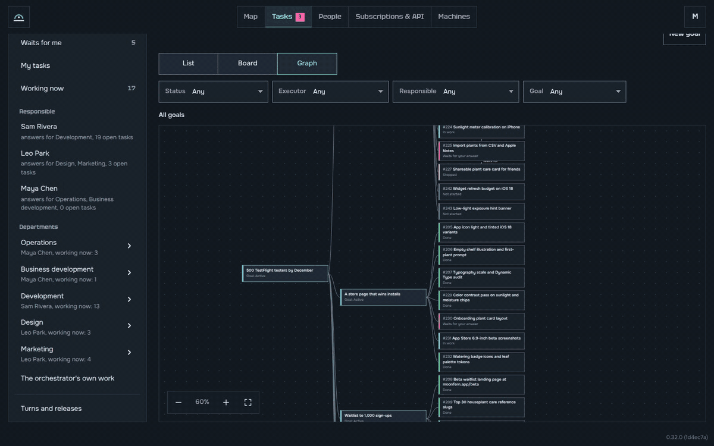
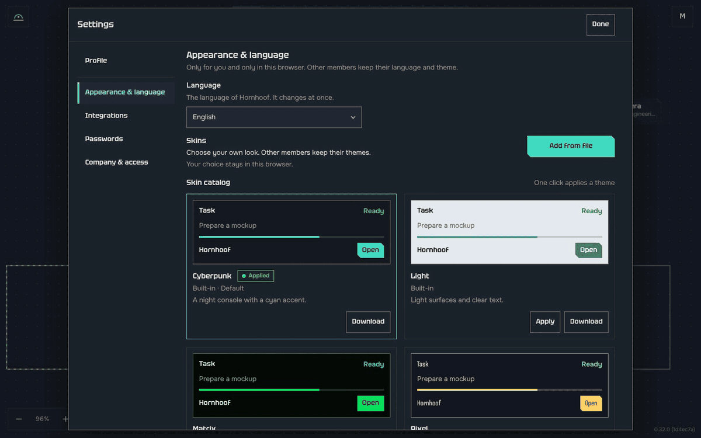

# Hornhoof

**Your own company of AI agents: any models, your own computers.**

Hornhoof is a system for running AI agents as one company. It works with any models: through subscriptions like Claude, ChatGPT, Kimi, GLM or Google, through API keys, and with new models as they come out. Each employee is a real AI program on your own plan, such as Claude Code, Codex, Kimi Code or Antigravity, and one department can mix them freely. You describe the task in plain words. The orchestrator, the main agent, splits it between departments, each with a head and employees, and agents on different models check each other's work. You see everything on one map and get the finished result.

It is your own virtual cloud. It runs on the computers you connect, one or many, yours or your team's. No cloud provider, no third-party servers, no account to make. Free and open source.

<div align="center">
<table>
  <tbody><tr>
    <td align="center" colspan="7"><strong>AI plans and API keys</strong></td>
  </tr></tbody>
  <tbody><tr>
    <td align="center" valign="top"><br/><sub>Claude Code</sub></td>
    <td align="center" valign="top"><br/><sub>Codex</sub></td>
    <td align="center" valign="top"><picture><source media="(prefers-color-scheme: dark)" srcset=".github/assets/logos/kimi-dark.svg" /></picture><br/><sub>Kimi Code</sub></td>
    <td align="center" valign="top"><picture><source media="(prefers-color-scheme: dark)" srcset=".github/assets/logos/zai-dark.svg" /></picture><br/><sub>GLM<br/>(Z.ai)</sub></td>
    <td align="center" valign="top"><br/><sub>Google<br/>Antigravity</sub></td>
    <td align="center" valign="top"><picture><source media="(prefers-color-scheme: dark)" srcset=".github/assets/logos/anthropic-dark.svg" /></picture><br/><sub>Anthropic<br/>API</sub></td>
    <td align="center" valign="top"><picture><source media="(prefers-color-scheme: dark)" srcset=".github/assets/logos/openai-dark.svg" /></picture><br/><sub>OpenAI<br/>API</sub></td>
  </tr></tbody>
  <tbody><tr>
    <td align="center" colspan="2"><strong>Personal assistants</strong></td>
    <td align="center"><strong>Chat</strong></td>
    <td align="center" colspan="3"><strong>Computers</strong></td>
  </tr></tbody>
  <tbody><tr>
    <td align="center" valign="top"><br/><sub>OpenClaw</sub></td>
    <td align="center" valign="top"><picture><source media="(prefers-color-scheme: dark)" srcset=".github/assets/logos/hermes-agent-dark.svg" /></picture><br/><sub>Hermes<br/>Agent</sub></td>
    <td align="center" valign="top"><br/><sub>Telegram</sub></td>
    <td align="center" valign="top"><picture><source media="(prefers-color-scheme: dark)" srcset=".github/assets/logos/macos-dark.svg" /></picture><br/><sub>macOS</sub></td>
    <td align="center" valign="top"><picture><source media="(prefers-color-scheme: dark)" srcset=".github/assets/logos/linux-dark.svg" /></picture><br/><sub>Linux</sub></td>
    <td align="center" valign="top"><picture><source media="(prefers-color-scheme: dark)" srcset=".github/assets/logos/windows-dark.svg" /></picture><br/><sub>Windows<br/>(WSL 2)</sub></td>
  </tr></tbody>
</table>
</div>

## Hornhoof is for you if

- ✅ You have many Claude Code or Codex windows open and no longer remember which one does what.
- ✅ You and a few friends want to build something together, and each of you has your own AI plans.
- ✅ You pay for more than one AI plan and want all of them working, not waiting.
- ✅ You have a spare laptop, a home server or an old Mac that sits idle most of the day.
- ✅ You want to give a goal and get a checked result, not watch every step.
- ✅ You want fifty files reviewed, or one text put into twenty languages, side by side and not one by one.
- ✅ You want your home looked after too: devices, network, shopping, bills.
- ✅ You want it all on your own machines, under your own control.

## What changes

| | AI programs on their own | With Hornhoof |
| --- | :---: | :---: |
| Your plans and your friends' plans work on one job at the same time | ❌ | ✅ |
| Work goes on when a plan hits its limit | ❌ | ✅ |
| Every change is reviewed by another agent, preferably of another maker, then tested, and checked for security where it matters | ❌ | ✅ |
| One map shows every agent, what it does now and who stands idle | ❌ | ✅ |
| Any agent starts many one-shot calls at once, and every answer stays in the task's history | ❌ | ✅ |
| A task tracker with goals, owners, dates, a board and a graph, kept by the agents themselves | ❌ | ✅ |
| Spare computers take the full test runs | ❌ | ✅ |
| The company keeps running when one of your computers stops | ❌ | ✅ |
| Releases wait for your yes, or go out by themselves once every check is green, as you choose | ❌ | ✅ |
| Departments beyond code: design, marketing, sales, the home | ❌ | ✅ |
| Runs on your own machines, with no sign-up | ✅ | ✅ |

"AI programs on their own" means Claude Code, Codex, Kimi Code and the like, each in its own window. Hornhoof runs them for you as one team.

## How it starts

1. Install Hornhoof with one line in the terminal. On a Mac, press `Cmd` and `Space`, type `Terminal` and press `Enter`. On Linux, press `Ctrl`, `Alt` and `T`. On Windows, the server runs in WSL: open its Ubuntu terminal. Docker installs itself if it is missing.

   ```sh
   curl -fsSL https://raw.githubusercontent.com/Invariant0x/hornhoof/main/scripts/install.sh | bash -s -- server
   ```

   On a computer that already runs Hornhoof, yours or another person's, it asks a name for the new company, such as `home`, and sets it up apart, with its own database and port. `server --name home` gives the name without the question.

2. Open the link it shows, name your company and pick one of nine templates. You are the CEO.

   

3. Connect your AI plans, add your computers with one command each, and invite friends with a link so they bring theirs. On a Windows computer, run the command Hornhoof shows for Windows in PowerShell: it installs Docker Desktop if it is missing, after Windows asks once to allow it.

   

4. Tell the orchestrator what you are building. He proposes departments, and you create them with one click.

   

5. Give a goal, like "Launch the iOS beta by Friday", and watch the company work on the map.

   

Works with **Claude Code**, **Codex** (ChatGPT plans), **Kimi Code**, the **GLM Coding Plan** and **Google Antigravity**, and with Anthropic and OpenAI API keys. Mix them as you like: in one department a developer on Claude Code, a reviewer on Codex and a tester on Kimi Code can work on the same task. New programs and models are added as they come out. When a new version is out, one "Update" button moves every machine to it.

## For a startup or a team of friends

*Everyone brings what they have. The company uses all of it.*

- **Plans add up.** Each person connects their own plans on their own computer. All of them work on the same goal at once, and when one runs out, its task goes to the same role on another plan.
- **Computers add up.** Laptops, a Mac mini and an old server become one pool. The full test run splits across the freest machines. If the computer with the server turns off, a machine with a full copy of the data takes over within a minute, at the same link.
- **Everyone sees their part.** Each person gets the departments they work in, and inside them the agents on their own plans. Someone who runs several departments sits next to the CEO as a deputy.
- **Sign-ins stay with their owners.** Your plan's sign-in is sealed to your own machines. Nobody else can read it, the CEO included.
- **Real departments from day one.** Development, design, marketing, sales, support, finance. Nine company templates, each department with a head and employees who know their job.





## Any work, not only code

*Marketing, content, sales and support run the same way as development.*

- **A department for every kind of work.** Each has a head and employees who each know one part of the job. In marketing a search specialist, a social media manager and a copywriter work on one campaign; in support the first line answers, the second line takes the hard cases and an editor keeps the knowledge base. The head splits the goal, hands out the parts and checks the result.
- **Agents work like people.** A letter goes out from the department's own mailbox, social networks go through the company's Android phones, and each step is written down in the department's git. There is no mailing machinery: like Lego, a department builds what it needs from a mailbox, a phone, a script and a skill.
- **A library to start from.** 10 departments, 64 roles and over 150 skills from the best practices of each field: campaign plans, copywriting and editing, SEO audits, social posts, market sizing, marketplace listings, sales, support and finance. Development, design and operations run every day in Hornhoof's own company, and what works there goes back into the templates.
- **Your own way of working.** Change any employee's role and skills on its card, or write your own roles, skills and departments. The company puts them to work on the next task.

## Ways of working

*Pick the shape that fits the job, and mix them in one company.*

- **Standing employees.** Each keeps its place in a department, its memory and its terminal, and can ask a person midway. *A developer who knows the app takes bug after bug all week.*
- **Turnkey teams.** One member does a task whole, with its own checks and tests. *A small fix goes out within the hour.*
- **Routes of stages.** A task passes from owner to owner: written, reviewed by an agent of another maker, tested. A stage can hand in a document instead of code. *An article goes from its writer to an editor.*
- **One-shot calls.** Any agent runs its program once per piece, like `claude -p` or `codex exec`, whatever the program. Each call starts fresh, answers and ends, and a judge call can weigh all the answers. Thousands can queue: as many run at once as free memory holds, within the plan's limits. *Thirty plant care pages are written side by side, then one judge reads them all.*
- **Pipelines of calls.** Calls in steps, spread out and brought together, driven by the agent who holds the task or by a one-shot stage of the route. *Five calls chase five causes of a bug, and one more checks the cause that held.*
- **Personal assistants.** Your own assistant, such as OpenClaw or Hermes Agent, works in the company with your rights. *From your chat you ask how the beta is going.*



| The job | The way |
| --- | --- |
| Days of work, questions midway, a phone or a browser | A standing employee |
| A small whole task, done quickly | A turnkey team |
| Must be checked by someone else | A route of stages |
| Many like pieces with no talk between them | One-shot calls |
| Spread out, then brought together | A pipeline of calls |
| Your own errands, from your chat | Your personal assistant |
| A program stuck on a question on its screen | The program operator, by itself |

## For your home

*Your home is a company too.*

- **Every device, watched.** One agent looks after the Wi-Fi and the router, another keeps the smart devices updated and tuned, and the department always knows the state of every device.
- **Strangers on your network.** A device nobody recognises on the Wi-Fi gets found, and you decide what to do about it.
- **The household runs itself.** One agent keeps the shopping list and supplies and drafts the orders, one tracks bills and subscriptions, one keeps the family calendar and chores.
- **Nothing happens behind your back.** Anything that changes a real device, buys something or pays for it waits for a person to say yes.
- **Runs on what you have.** An old laptop or a home server carries the work.



## See the work live

*Who works, who waits and who stands idle, right now.*

- **A work tree for every department.** Each agent is a line with its task, and each state has its own color: working, waiting for another task, waiting for a person, standing idle. Work that is handed in merges into the turn's branch before your eyes.
- **The speed of every turn.** How long each agent worked, waited and stood idle, and every wait with since when, so you see where the time goes.
- **A live terminal for every agent.** The real Claude Code, Codex, Kimi or Antigravity screen in your browser, whichever machine it runs on. Any line of the tree opens it.






## You decide, they do

- **One list for everything that needs you.** Questions, design choices and approvals wait in one place, and you answer from any device, your phone too.
- **You are asked only about what cannot be undone.** By default only an irreversible deletion waits for the CEO. A department can add its own rules, as the home departments do for devices and money.
- **Work in turns.** A goal becomes a turn of tasks, and each turn ends in a numbered release.
- **Releases can go out by themselves.** With autonomous release on, a department's release reaches your main branch once its whole test run is green and every change in it was checked. With it off, the release waits for your yes on the exact commit.

## A task tracker

*Goals, owners and dates, as a list, a board or a graph.*

- **Your work first.** "My tasks", "Waits for me" and "Working now", with search and filters over every task.
- **One person answers for each task and goal**, with a why and a date. A goal can carry a number, like "500 testers by December".
- **Kept by the agents.** Cards move on the board as the work moves, by status or by the stages of a pipeline, and each department's product manager keeps titles and goals tidy. On a phone too.






## It gets better by itself

Hornhoof does not stay the way you installed it. Every company has an Operations department whose job is to make the company work better in your own setup:

- **A task watchdog** wakes every 10 minutes while there is work, nudges an agent that is stuck, and tells its head when that did not help.
- **A weak point collector** reads every three hours what failed and where agents stumbled, and writes each finding up with its facts and a fix.
- **Improvements** collect those fixes. You take one with a click, and the orchestrator does it or turns it into a task.
- **A program operator** keeps the AI programs moving. It passes their service windows on its own, such as an offer to compact a full context or a sign-in from the vault, and asks a person only for their own password or account and for what costs money.
- **A reliability engineer** restores broken machines, tools and integrations, finds the cause, and writes down how to handle it next time.

## Your own look

Pick a skin, Cyberpunk, Light, Matrix or Pixel, or make your own from any idea: download one as a sample, ask any AI to change it, and add the file.



## Next to the alternatives

"Parallel agent apps" run several coding agents side by side, each on its own copy of the code.

| | One AI program | Parallel agent apps | Hornhoof |
| --- | :---: | :---: | :---: |
| Agents of different makers work on one job at the same time | ❌ | ⚠️ side by side, you coordinate | ✅ |
| A main agent splits the work and hands it out | ❌ | ⚠️ some | ✅ |
| Each change reviewed by another agent, preferably of another maker, then tested, and checked for security where it matters | ❌ | ❌ | ✅ |
| Work goes on when a plan hits its limit | ❌ | ❌ | ✅ |
| The full test run splits across your free computers | ❌ | ❌ | ✅ |
| Keeps running when the server's computer turns off | ❌ | ❌ | ✅ |
| Live terminal of every agent in the browser, on any machine | ❌ | ⚠️ this computer only | ✅ |
| Several people, each with their own plans and departments | ❌ | ❌ | ✅ |
| Departments beyond code, and the home | ❌ | ❌ | ✅ |

### Claude Cowork and the Codex app

Claude Cowork gives one person a lead Claude with sub-agents that return summaries. The Codex app gives one developer agents in git worktrees to merge by hand. Hornhoof is a company that stays, on any program, where review, tests and releases bring the work together.

## Hornhoof builds itself

Hornhoof is developed inside Hornhoof. Its own company of agents on Claude, ChatGPT, Kimi and Google plans takes the tasks, writes the code, reviews it across makers, tests it and ships every turn as a release, the way large companies run on their own products.

## Let's build it together

I built Hornhoof for myself, to make working with AI convenient: several plans, several computers and far too many terminal tabs, working as one team. On the way I gathered what actually works: how to split work so agents do not wait on each other, which checks catch real bugs and which only slow things down, how to keep agents moving without babysitting them. All of it is in the templates, 64 roles and over 150 skills that every company starts with.

Let's join forces and make it the best way to run AI agents: the fastest, the most reliable, safe, and fully yours. The code is open under MIT, and Hornhoof's own company puts what you add to work right away. Try it and tell me what broke, bring the practices that work for you, write templates for departments and roles, translate the screens, or pick an open issue.

Start with [CONTRIBUTING.md](CONTRIBUTING.md). Please read the [code of conduct](CODE_OF_CONDUCT.md), and report security problems privately, as [SECURITY.md](SECURITY.md) says.

## Good to know

- **Each agent is a real program on your machine.** More agents need more memory. Spare computers help.
- **Hornhoof is young.** It works and changes fast. Expect rough edges, and tell me about them.

## Your company stays yours

- It runs on your machines. No Hornhoof cloud, no account with us.
- Its data sits only on machines of the CEO and of people who see the whole company, and backups are encrypted.
- Every employee works in a locked box: a container with no folder of your computer in it, as a user of its own, unable to read the machine's keys or other plans.
- The orchestrator acts as the owner, with a shell in the server and Hornhoof's own rights over its database.
- Root on a machine opens only when that machine's owner allows it, for a day at most.
- Keys and tokens show as `[hidden]` in every terminal and output.
- The hornhoof.org link is optional, and it passes your traffic on encrypted, unable to read it.

[SECURITY.md](SECURITY.md) explains each point.

## What comes next

| What is coming | What it gives you |
| --- | --- |
| Direct links between machines in different homes | Machines connect to each other directly, without going through the public link |
| More machines holding the company's data | The company's data lives on five machines out of ten instead of three |
| Phones and tablets as workers | One Android app turns a phone or tablet on a charger into a full machine of the company: agents, tests and checks on a real device |
| Schemes to share | Save a department or the whole company with its agents and skills as one file, load someone else's in a click, and its agents start working |

Want to add something? [Write to us](https://github.com/Invariant0x/hornhoof/issues) and let's build it.

## Questions

**Does it cost anything?** No. You use the AI plans you already have. Hornhoof is free and open source.

**How is it different from Claude Code or Codex?** Hornhoof uses them. They are the employees, Hornhoof is the company around them.

**Is it only for code?** No. There are templates for marketing, sales, support, research, finance and the home.

**Does my data go to you?** No. The AI programs talk to their makers as always, and nothing goes to us.

**Can I use my phone?** Yes, to watch, answer and approve from the browser.

**My server runs on a Mac and was updated by the Update button. Do I need to do anything for other machines to find it?** Run the install line once on that Mac. Until then your other machines reach the server only through its hornhoof.org link, which works but needs the internet; after it they also find the Mac on your own network. A server on Linux learns this by itself.

**What if the hornhoof.org link stops opening after an update?** Put `ACME_DIRECTORY=off` in the `.env` file in the `~/hornhoof` folder and run `docker compose up -d app` there. The link opens again within a minute, with its https ending at hornhoof.org as before. Then tell us in an issue.

## What Hornhoof is not

- Not a cloud service. There is no sign-up and no account with us.
- Not a new AI. It runs the AI programs you already use.
- Not a chat. Work is tasks, each with an owner, a review and a result.

## Learn more

The [guide](guide/README.md) explains every part, one topic per page: [install](guide/install.md), [the public link](guide/public-link.md), [machines and plans](guide/machines-and-plans.md), [the orchestrator](guide/orchestrator.md), [departments and employees](guide/departments-and-employees.md), [tasks and turns](guide/tasks-and-turns.md), [repositories](guide/repositories.md), [tests on free machines](guide/free-machines.md), [updates](guide/updates.md) and [security](SECURITY.md). More examples are in [EXAMPLES.md](EXAMPLES.md).

## License

MIT, see [LICENSE](LICENSE). Copyright (c) 2026 Ivan Korol. The templates in `templates/` and the programs every node carries come from projects with their own licences, listed in `templates/SOURCES.md`.
