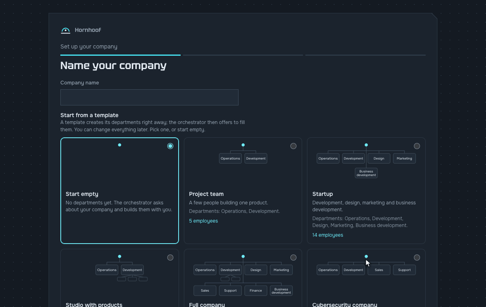
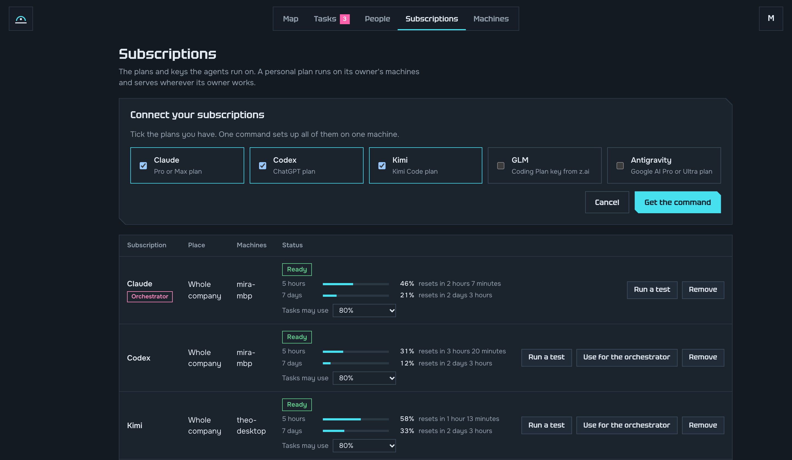
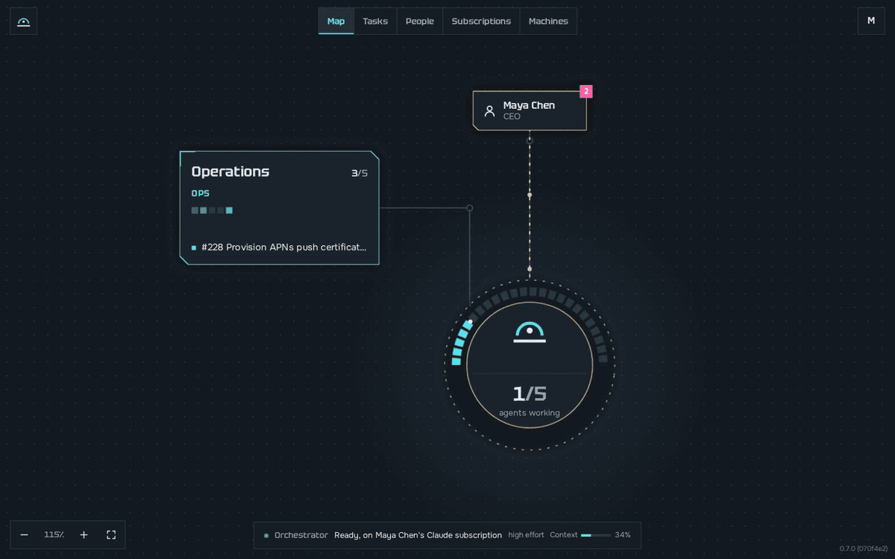
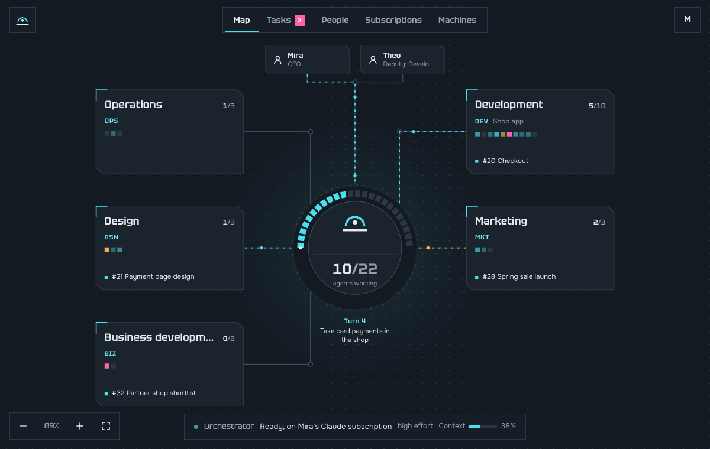
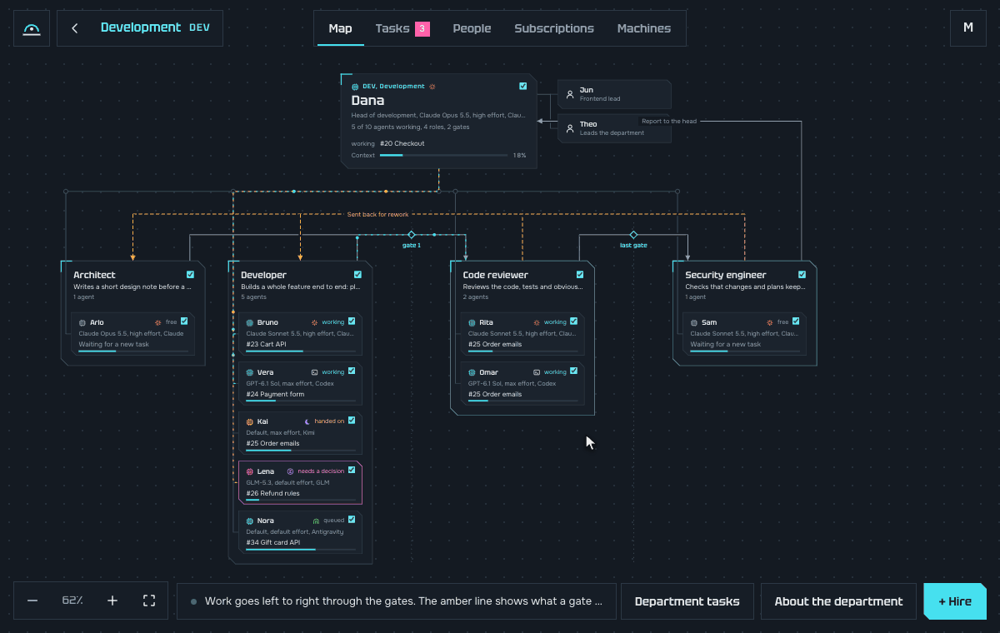
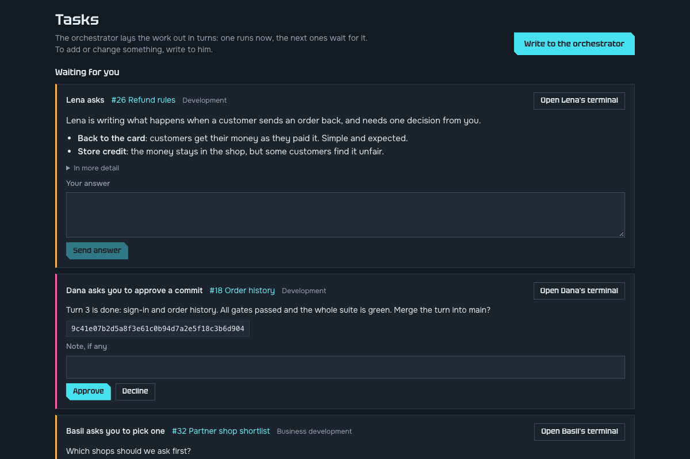
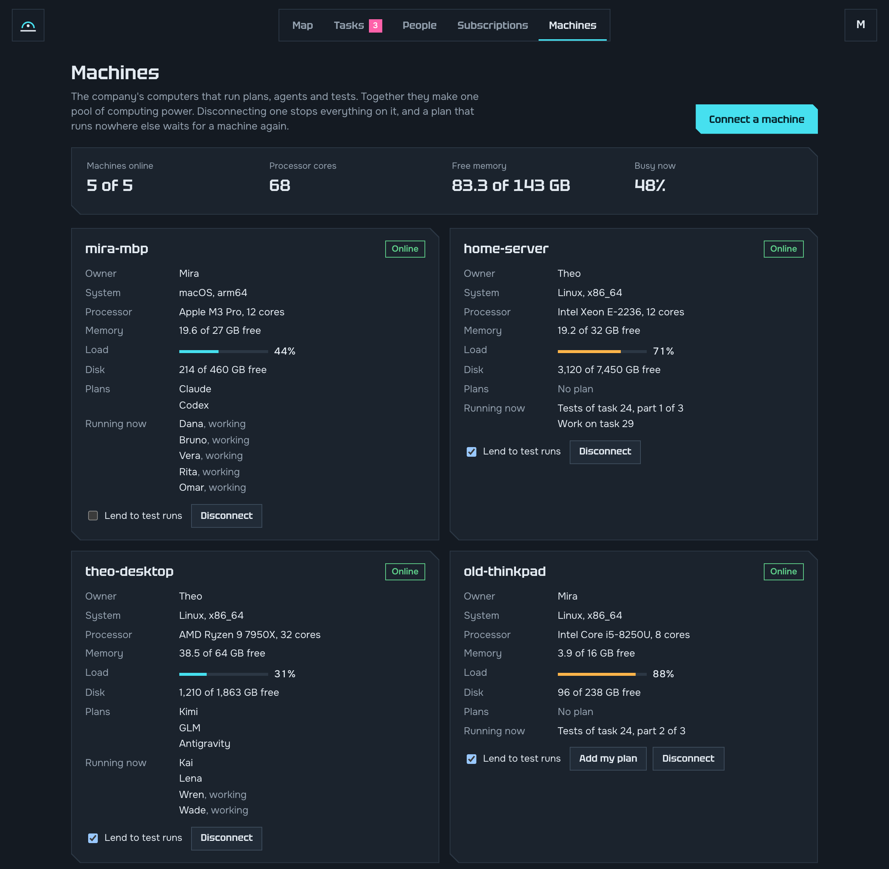

# Hornhoof

**Your own company of AI agents, on your own computers.**

Hornhoof turns the AI plans you already pay for, like Claude, ChatGPT, Kimi, GLM or Google AI, into a company that works for you.

You write what you want in plain words. The orchestrator, the main agent, splits it into tasks and gives them to departments. Every department has a head and employees, and every employee is an AI agent. You watch all of them on one map, see what each one is doing right now, and step in only when someone asks you.

It all runs on your own computers. There is no account to make and nothing to sign up for.

Hornhoof is young. It works, and it changes fast. Expect rough edges, and tell us about them.

## Hornhoof is for you if

- ✅ You pay for more than one AI plan and want all of them working, not waiting.
- ✅ You have ten Claude Code or Codex windows open and no longer remember which one does what.
- ✅ You want to give a goal and get the result, not watch every step.
- ✅ You and a few friends each have a plan and want to build something together.
- ✅ You have an old laptop, a home server or a spare Mac that sits idle most of the day.
- ✅ You want to look in from your phone, wherever you are.
- ✅ You want it all on your own machines, under your own control.

## What changes

| | AI programs on their own | With Hornhoof |
| --- | :---: | :---: |
| All your AI plans work at the same time, on one job | ❌ | ✅ |
| Work goes on when a plan hits its limit | ❌ | ✅ |
| Agents hand work to each other, without you copying it over | ❌ | ✅ |
| Every change is reviewed by an AI of another maker | ❌ | ✅ |
| Nothing reaches the main branch until you approve it | ❌ | ✅ |
| One map shows what every agent is doing right now | ❌ | ✅ |
| Spare computers take tests and heavy jobs | ❌ | ✅ |
| Friends join with their own plans | ❌ | ✅ |
| Runs on your own machines, with no sign-up | ✅ | ✅ |

"AI programs on their own" means Claude Code, Codex, Kimi Code and the like, each in its own window. Hornhoof runs them for you as one team.

## How it works

The pictures show Moonfern, a made-up company. Its people, plans and work are invented for the demo.

1. Install Hornhoof with one line in the terminal.

2. Open the link it shows. Name your company and pick a template, or start empty.

   

3. Connect your AI plans. Each plan signs in on your own computer, in a small locked box of its own.

   

4. Tell the orchestrator about your company. He proposes departments and people for them. You tick what you want and click once.

   

5. Write what you need. The orchestrator packs it into a turn of tasks, the heads hand out the work, and you watch it move on the map.

   

## What people do with it

### Many AI plans working as one team

Say you have Claude, ChatGPT and Kimi. Usually you work in one of them while the others wait. In Hornhoof each plan carries its own employees, so developers on Claude, on Codex and on Kimi take different tasks of the same job at the same time.

A change written on one maker's model is checked by reviewers on the others, because each of them catches mistakes the others miss. When one plan reaches its limit, its task goes to an employee of the same role on another plan, or waits until the limit resets and then goes on by itself. You set how much of each plan's limit the tasks may use, so some is always left for you.


### Too many windows

Instead of a dozen chats you have one company. You write to the orchestrator once, he turns it into tasks, and each department's head gives them out. Every employee works in its own terminal, which you can open, watch live and type into. When an agent needs you, its question waits for you at the top of Tasks, so you answer everything in one place.





### Every computer you have helps

Connect your work laptop, an old one and a server, each with one command. The Machines tab shows them as one pool: how many cores and how much free memory they have together, and how busy each one is. Tests and other heavy work go to whichever machine is free, while the agents keep working where they are.



### Building something with friends

Invite each friend with a link. Everyone connects their own plan on their own computer, so their agents work for the shared company while their sign-in never leaves their machine. Give each person the departments they work in, and they see only those. Someone who works across several departments shows up next to the CEO on the map as a deputy.

### Several products

Put a product under a department for each thing you build, each with its own git repository. The Studio template sets this up: one development department with several products under it.

### A home full of devices

The Home template gives you a department that looks after the Wi-Fi, the router and the smart home, and a household department for shopping lists, bills and the family calendar. Anything that touches a real device or spends money waits for a person to say yes.

More examples, from a cybersecurity company to several companies on one computer, are in [EXAMPLES.md](EXAMPLES.md).

## Install

You need a computer with macOS or Linux. Windows is not supported yet. Docker is installed for you if it is missing.

1. Open a terminal. On a Mac, press `Cmd` and `Space`, type `Terminal` and press `Enter`. On Linux, like Ubuntu, press `Ctrl`, `Alt` and `T`.

2. Copy this line, paste it into the terminal and press `Enter`:

   ```sh
   curl -fsSL https://raw.githubusercontent.com/Invariant0x/hornhoof/main/scripts/install.sh | bash -s -- server
   ```

3. Answer its questions. It may ask for your computer's password, to install Docker. When it asks for the address people will open Hornhoof at, just press `Enter`.

4. Wait a few minutes. The first time, it downloads Hornhoof. At the end it shows a link like `http://localhost:8080/setup?code=...`.

5. Open that link in your browser and follow the steps. Name your company, pick a template, and create your account: you become the CEO. Then choose how the orchestrator runs. "My subscription" gives you one more command to run in the terminal. It opens your plan's sign-in page, and the orchestrator starts as soon as you sign in.

Now you are on the map, with the orchestrator in the middle. Click him and tell him about your company.

### Add more later

- To add another computer, open Machines, click "Connect a machine", copy the command and run it in a terminal on that computer.
- To add your AI plans, open Subscriptions, click "Connect a subscription", tick your plans, and run the command on the computer that will carry them. Each plan opens its own sign-in.
- To invite a friend, open People, click "Invite person" and send them the link.
- When a new version is out, Hornhoof shows a banner with an "Update" button. Running the install line again updates too.

### Remove it

- To remove what Hornhoof put on a connected computer, run `curl -fsSL <your Hornhoof address>/install.sh | bash -s -- --uninstall` on it.
- To remove the server, run `docker compose down -v` in the `~/hornhoof` folder and delete the folder. This deletes all of the company's data.

## Questions

**Does Hornhoof cost anything?**
No. You use the AI plans you already have. Hornhoof itself is free.

**Which AI plans work?**
Claude plans through Claude Code, ChatGPT plans through Codex, Kimi Code, the GLM Coding Plan from z.ai, and Google AI Pro or Ultra through Antigravity. A company can also use Anthropic or OpenAI API keys.

**Does my data go to you?**
No. Hornhoof runs on your computers, and the AI programs talk to their makers as they always do. The optional hornhoof.org link only passes the traffic on. It has no accounts and keeps nothing.

**Is it safe to let agents work on their own?**
Every agent runs in a locked box on the machine, as a user of its own, and cannot read the keys of the machine or of other plans. Nothing reaches the main branch until you approve the exact change, and anything that acts on a real device or spends money waits for a person. Agents still make mistakes, so give them access only to what they need, like a token for one repository.

**What happens when a computer turns off?**
Its employees move to another machine with the same plan, or wait until it comes back. A test run it was doing starts again on another machine.

**How is this different from Claude Code or Codex?**
Hornhoof uses them. They are the employees, and Hornhoof is the company around them: departments, tasks, reviews and one view of it all.

**Can I use my phone?**
You can open and run your company from the phone's browser. Phones that do work themselves, like an old Android on a charger, are coming next.

## What Hornhoof is not

- It is not a cloud service. There is no sign-up and no account with us. It is yours, on your machines.
- It is not a new AI. It runs the AI programs you already use.
- It is not a chat. Work is tasks, each with someone who owns it, a review and a result.
- It is not only for code. There are templates for marketing, sales, support, research, finance and the home.

## Help build Hornhoof

Hornhoof is built by a few people and a lot of agents, and we are looking for more of both. If you want a company of agents of your own and want to shape how it works, join us. You can:

- try it and tell us what broke or what confused you;
- bring ideas for what would make your own company of agents work better;
- translate the screens, which are in English and Russian now;
- write templates for departments, roles and skills that fit any company;
- fix and build things, starting with an issue marked "good first issue".

Start with [CONTRIBUTING.md](CONTRIBUTING.md). Please read the [code of conduct](CODE_OF_CONDUCT.md), and report security problems privately, as [SECURITY.md](SECURITY.md) says.

## Learn more

The [guide](guide/README.md) explains how Hornhoof works, in detail, one topic per page:

- [Install and run the server](guide/install.md): what the install line does, several companies on one computer, running from source, your own domain, and a forgotten password.
- [The link on the internet](guide/public-link.md): how people open your company from anywhere, and who can reach it.
- [Machines and plans](guide/machines-and-plans.md): how to connect your AI plans and computers, how agents are kept apart, and what happens when a plan hits its limit.
- [The orchestrator](guide/orchestrator.md): what the main agent can do for you, and what stays with people.
- [Departments and employees](guide/departments-and-employees.md): the department schema, hiring, an employee's window and terminal, switching agents off, and reviews at a gate.
- [Tasks and turns](guide/tasks-and-turns.md): how your words become tasks, which checks they pass, and what happens when an agent gets stuck.
- [Repositories](guide/repositories.md): how a department gets a git repository, and where its token goes.
- [Tests and heavy work on free machines](guide/free-machines.md): where tests run, which machines take them, and what happens when a machine goes away.
- [Updates](guide/updates.md): how a new version arrives, how to go back, and how to take back a public link after an update went back.

## License

Hornhoof is free and open source under the [MIT License](LICENSE). Copyright (c) 2026 Ivan Korol.

The templates in `templates/` and the programs every node carries come from projects with their own licences, which `templates/SOURCES.md` lists.
