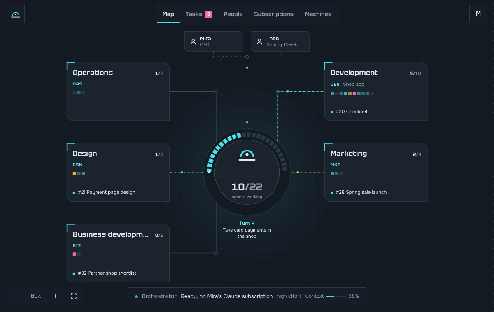
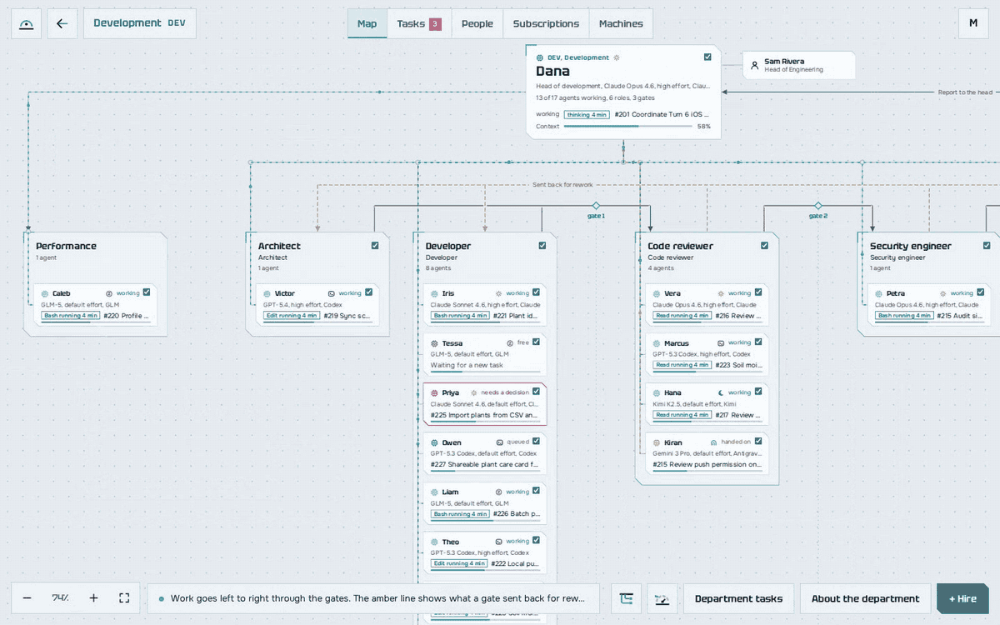
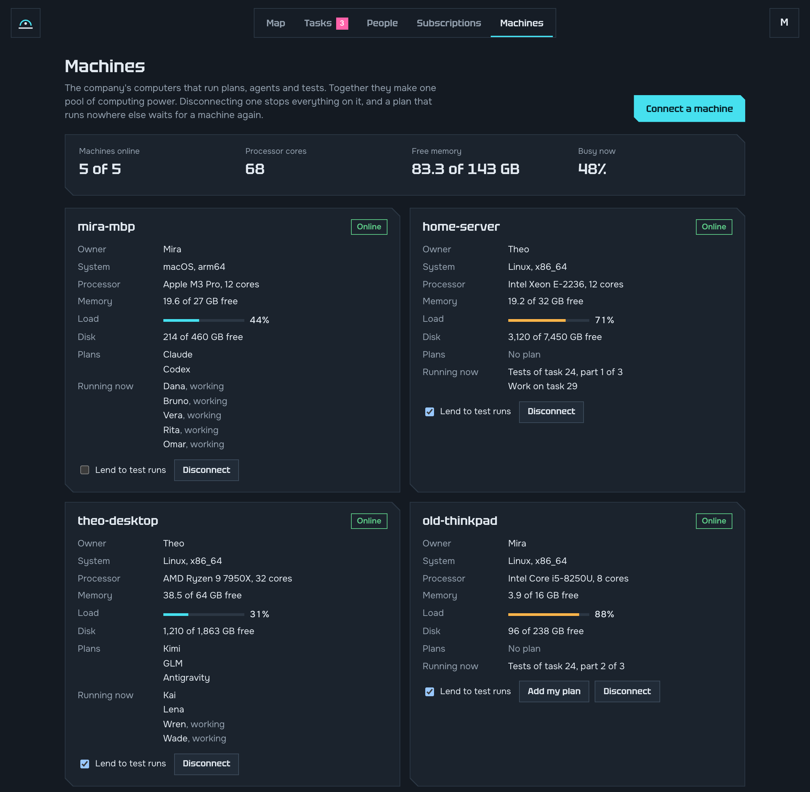
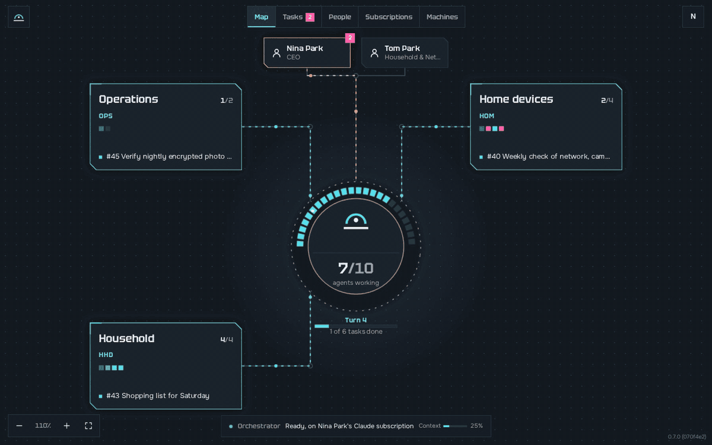
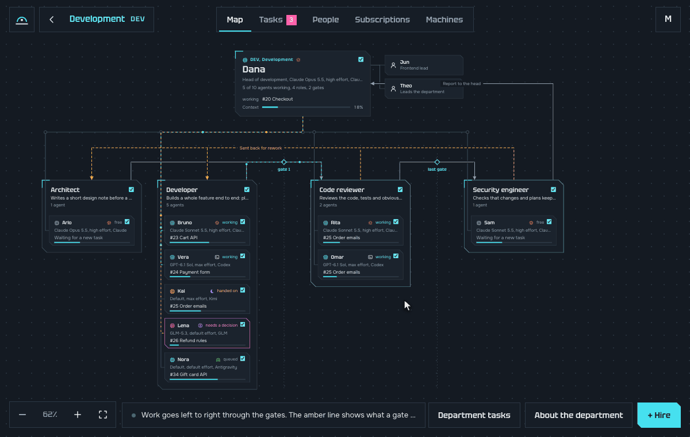
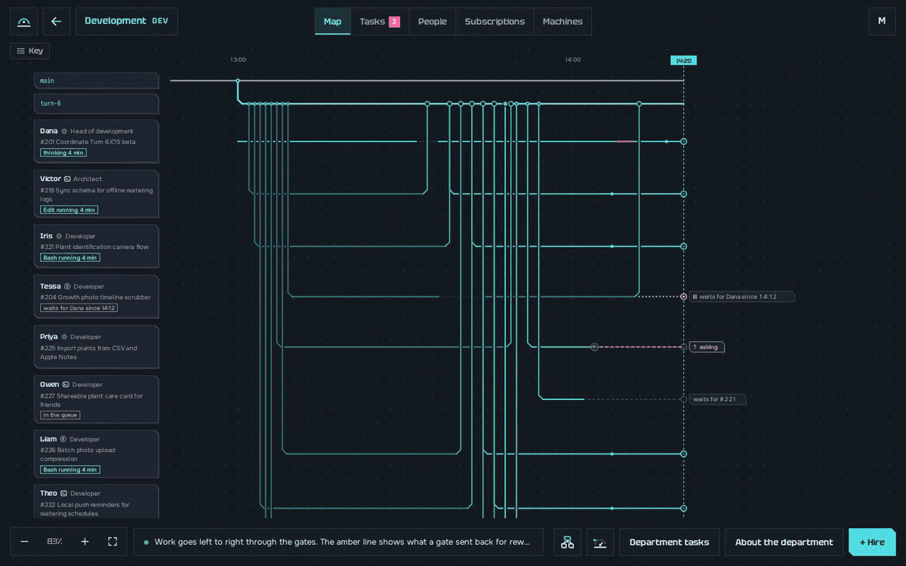
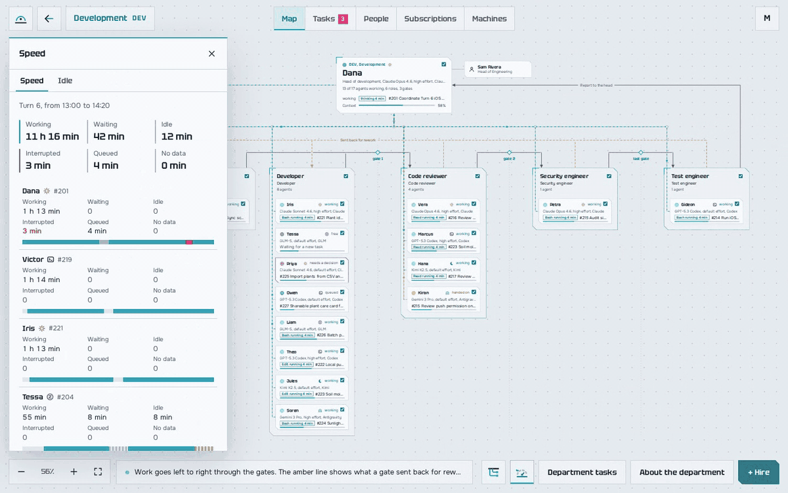
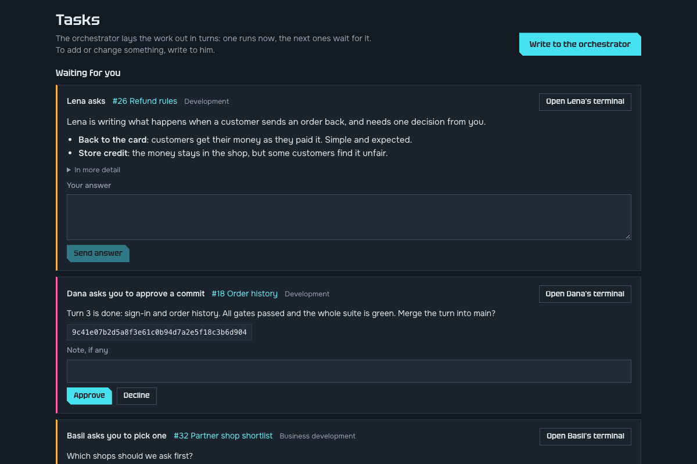
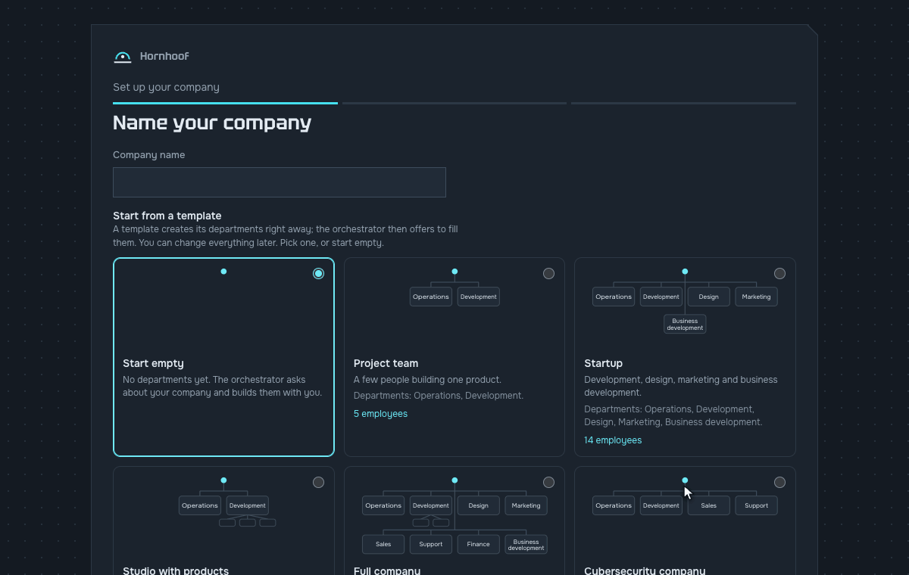
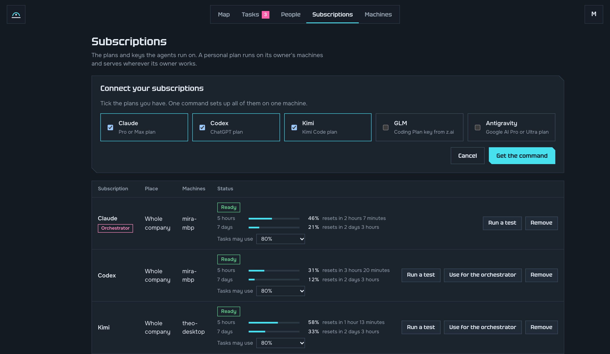

# Hornhoof

**Ваши ИИ-агенты работают одной командой.**

Когда вы работаете сразу с несколькими ИИ-программами, легко запутаться, какая из них что делает. Если вы делаете что-то вместе с друзьями, у каждого свои тарифы, и они работают порознь. А если у вас несколько компьютеров, работу обычно тянет только один.

Hornhoof собирает все это в одну команду. Вы обычными словами описываете задачу. Hornhoof делит ее между отделами ИИ-агентов, запускает их на тарифах и компьютерах всех участников, агенты разных производителей проверяют работу друг друга, и вы получаете готовый результат.

Открытый код, на ваших машинах, без регистрации.



```sh
curl -fsSL https://raw.githubusercontent.com/Invariant0x/hornhoof/main/scripts/install.sh | bash -s -- server
```

Работает с **Claude Code**, **Codex** (тарифы ChatGPT), **Kimi Code**, **GLM Coding Plan** и **Google Antigravity**, а также с API-ключами Anthropic и OpenAI.

| | Шаг | Пример |
| --- | --- | --- |
| **1** | Создайте компанию | «Moonfern» из шаблона «Стартап»: разработка, дизайн, маркетинг, развитие бизнеса. |
| **2** | Принесите тарифы и компьютеры | Три друга приносят семь ИИ-тарифов и десять компьютеров: 112 ядер и 296 ГБ памяти в одном пуле. |
| **3** | Поставьте цель, заберите результат | «Выпустить бету для iOS к пятнице.» Отделы делают работу, вы забираете выпуск. |

## Hornhoof для вас, если

- ✅ Вы с другом или небольшой командой что-то строите, и у каждого свои ИИ-тарифы.
- ✅ Вашему стартапу нужно, чтобы разработка, дизайн и маркетинг двигались одновременно, еще до найма людей.
- ✅ Вы хотите, чтобы за домом следили как за компанией: устройства, сеть, покупки, счета.
- ✅ У вас открыто двадцать вкладок Claude Code или Codex, и вы теряете, кто что делает.
- ✅ У вас есть компьютеры, которые почти весь день простаивают.
- ✅ Вы хотите заглядывать, отвечать и одобрять с телефона.

## Для стартапа или команды друзей

*Каждый приносит, что у него есть. Компания использует все.*

- **Тарифы складываются.** Каждый подключает свои тарифы на своем компьютере. Все они работают на одну цель сразу, а когда один кончается, его задача уходит той же роли на другом тарифе.
- **Компьютеры складываются.** Ноутбуки, Mac mini и старый сервер становятся одним пулом. Тесты идут на самую свободную машину и делятся между несколькими. Если компьютер с сервером выключится, следующий подхватит за минуту, по той же ссылке.
- **Каждый видит свою часть.** Каждый человек получает отделы, в которых работает, а внутри них агентов на своих тарифах. Тот, кто ведет несколько отделов, сидит рядом с CEO как заместитель.
- **Входы остаются у владельцев.** Вход в ваш тариф привязан к вашим машинам. Никто другой не может его прочитать, даже CEO.
- **Настоящие отделы с первого дня.** Разработка, дизайн, маркетинг, продажи, поддержка, финансы. Девять шаблонов компаний, в каждом отделе руководитель и сотрудники, которые знают свою работу.





## Для вашего дома

*Ваш дом тоже компания.*

- **Каждое устройство под присмотром.** Один агент следит за Wi-Fi и роутером, другой держит умные устройства обновленными и настроенными, и отдел всегда знает состояние каждого устройства.
- **Никакого мусора на устройствах.** Приложения, расширения и настройки, которых там быть не должно, находятся, и вы получаете список, что удалить.
- **Хозяйство ведется само.** Один агент ведет список покупок и запасы и готовит заказы, другой следит за счетами и подписками, третий ведет семейный календарь и дела.
- **Ничего за вашей спиной.** Все, что меняет настоящее устройство, что-то покупает или оплачивает, ждет «да» от человека.
- **Работает на том, что есть.** Старый ноутбук или домашний сервер тянет всю работу.



## Чем Hornhoof отличается

| | |
| --- | --- |
| **Все тарифы сразу** | Разработчики на Claude, Codex, Kimi, GLM и Google одновременно берут части одной работы. |
| **Все компьютеры как один** | Работу тянет один пул. Если компьютер с сервером остановился, другой подхватит за минуту, по той же ссылке. |
| **Каждую правку проверяет другой производитель** | Ревьюеры других производителей одновременно читают одну правку, потом безопасность, потом один прогон тестов на весь ход. |
| **Живой терминал у каждого агента** | Настоящий экран Claude Code, Codex, Kimi или Antigravity вживую в браузере, на какой бы машине он ни работал. |
| **Работа ходами** | Цель становится ходом из задач, и каждый ход заканчивается выпуском с номером. Без одобрения в main ничего не попадает. |
| **Улучшает сам себя** | Отдел Операций в каждой компании находит, что тормозит или ломается, и исправляет. |



## Работа видна вживую

*Кто работает, кто ждет и кто простаивает, прямо сейчас.*

- **Дерево работы у каждого отдела.** Каждый агент это линия со своей задачей, и у каждого состояния свой цвет: работает, ждет другую задачу, ждет ответа человека, простаивает. Сданная работа вливается в ветку хода у вас на глазах.
- **Скорость каждого хода.** Сколько каждый агент работал, ждал и простаивал, и каждое ожидание с того момента, как началось, чтобы было видно, куда уходит время.
- **Один клик до агента.** Любая линия открывает карточку агента или его живой терминал.





## Становится лучше сам

Hornhoof не остается таким, каким вы его поставили. В каждой компании есть отдел Операций, работа которого в том, чтобы компания лучше работала именно в вашей среде:

- **Сторож задач** просыпается каждые 10 минут, пока есть работа, подталкивает застрявшего агента и говорит его руководителю, если не помогло.
- **Сборщик слабых мест** каждые три часа читает, что сломалось и где агенты споткнулись, и записывает каждую находку с фактами и исправлением.
- **«Улучшения»** собирают эти исправления. Вы берете одно кликом, и оркестратор делает его сам или превращает в задачу.
- **Оператор программ** присматривает за самими ИИ-программами: пропускает безобидные экраны, отказывает в том, что программе нельзя, а входы и оплату приносит вам.
- **Инженер надежности** восстанавливает сломанные машины, инструменты и интеграции, находит причину и записывает, как действовать в следующий раз.

## Какие проблемы решает Hornhoof

| Без Hornhoof | С Hornhoof |
| --- | --- |
| Каждый из вас платит за ИИ-тарифы и пользуется ими один. | Тарифы всех работают на одну цель. |
| Двадцать вкладок с терминалами, и никто не знает, кто что делает. | Одна карта: каждый агент, что он делает сейчас, и его живой терминал. |
| Непонятно, какой агент работает, а какой застрял. | Дерево работы вживую показывает, кто работает, кто ждет и кто простаивает. |
| Тариф уперся в лимит, и работа встала. | Задача уходит той же роли на другом тарифе или ждет и продолжается сама. |
| Каждую правку вы читаете сами. | Ее проверяют агенты других производителей, потом безопасность, потом тесты. Вы забираете результат. |
| Запасные компьютеры простаивают. | Они гоняют тесты и тяжелую работу. |
| Ноутбук, на котором все, закрылся, и работа встала. | Другая машина подхватывает за минуту. |
| Домашние устройства и дела ничьи. | Домашний отдел присматривает за ними все время. |



## Рядом с альтернативами

«Программы с параллельными агентами» запускают несколько агентов рядом, каждого на своей копии кода.

| | Одна ИИ-программа | Программы с параллельными агентами | Hornhoof |
| --- | :---: | :---: | :---: |
| Агенты разных производителей одновременно работают над одной задачей | ❌ | ⚠️ рядом, координируете вы | ✅ |
| Главный агент делит работу и раздает ее | ❌ | ⚠️ у некоторых | ✅ |
| Каждую правку одновременно проверяют другие производители, потом безопасность, потом тесты | ❌ | ❌ | ✅ |
| Работа продолжается, когда тариф уперся в лимит | ❌ | ❌ | ✅ |
| Тесты идут на самый свободный из ваших компьютеров | ❌ | ❌ | ✅ |
| Работает дальше, когда компьютер с сервером выключился | ❌ | ❌ | ✅ |
| Живой терминал любого агента в браузере, на любой машине | ❌ | ⚠️ только этот компьютер | ✅ |
| Несколько людей, у каждого свои тарифы и отделы | ❌ | ❌ | ✅ |
| Отделы не только для кода, и дом | ❌ | ❌ | ✅ |

## Hornhoof строит сам себя

Hornhoof разрабатывается внутри Hornhoof. Его собственная компания агентов на тарифах Claude, ChatGPT, Kimi и Google берет задачи, пишет код, проверяет его силами разных производителей, тестирует и выпускает каждый ход как выпуск, так же как крупные компании работают на своих же продуктах.

## Давайте строить вместе

Я сделал Hornhoof для себя, чтобы с ИИ было удобно работать: несколько тарифов, несколько компьютеров и слишком много вкладок с терминалами работают одной командой. По дороге я собрал то, что действительно работает: как делить работу, чтобы агенты не ждали друг друга, какие проверки ловят настоящие ошибки, а какие только тормозят, как держать агентов в движении, не стоя у них над душой. Все это лежит в шаблонах: 50 ролей и больше 150 навыков, с которыми начинает каждая компания.

Давайте объединяться и сделаем из этого лучший способ управлять ИИ-агентами: самый быстрый, самый надежный, безопасный и полностью ваш. Код открыт по лицензии MIT, а собственная компания Hornhoof сразу пускает в работу то, что вы добавите. Попробуйте и расскажите, что сломалось, принесите практики, которые работают у вас, напишите шаблоны отделов и ролей, переведите экраны или возьмите задачу с пометкой «good first issue».

Начните с [CONTRIBUTING.md](CONTRIBUTING.md). Прочитайте [правила поведения](CODE_OF_CONDUCT.md), а о проблемах безопасности сообщайте приватно, как написано в [SECURITY.md](SECURITY.md).

## Быстрый старт

1. Откройте терминал. На Mac нажмите `Cmd` и `Space`, наберите `Terminal` и нажмите `Enter`. В Linux нажмите `Ctrl`, `Alt` и `T`. В Windows откройте терминал Ubuntu из WSL.
2. Вставьте строку из начала страницы и нажмите `Enter`. Docker поставится сам, если его нет.
3. Откройте ссылку, которую он покажет в конце, назовите компанию, выберите шаблон и создайте аккаунт. Вы CEO.
4. Подключите тариф, нажмите на оркестратора в центре карты и расскажите ему о своей компании.



Потом из приложения: **«Машины»**, чтобы добавить компьютер одной командой, **«Подписки»**, чтобы добавить ИИ-тарифы, **«Люди»**, чтобы пригласить друга ссылкой. Когда выходит новая версия, одна кнопка «Обновить» переводит на нее все машины.



## Что стоит знать

- **Он тратит ваши тарифы.** Занятая компания расходует лимиты намного быстрее, чем один человек в одном чате. Вы выбираете, сколько от каждого тарифа может брать компания, от 50 до 90%, чтобы вам всегда что-то оставалось.
- **Агенты все равно ошибаются.** Ревью ловит многое, но не все, поэтому без одобрения ничего не выходит. Давайте агентам только нужный доступ, например токен к одному репозиторию.
- **Прочитайте условия своего тарифа.** У каждого производителя свои правила, как можно пользоваться тарифом.
- **Каждый агент это настоящая программа на вашей машине.** Больше агентов требует больше памяти. Запасные компьютеры помогают.
- **Hornhoof молодой.** Он работает и быстро меняется. Будьте готовы к шероховатостям и рассказывайте мне о них.

## Ваша компания остается вашей

- Она работает на ваших машинах. Нет облака Hornhoof, нет аккаунта у нас.
- Ее данные лежат только на машинах CEO и людей, которые видят всю компанию, а резервные копии зашифрованы.
- Каждый агент работает в закрытой коробке: контейнер без единой папки вашего компьютера, своим пользователем, без доступа к ключам машины и чужим тарифам.
- Root на машине открывается только с разрешения владельца этой машины, максимум на сутки.
- Ключи и токены показываются как `[hidden]` в каждом терминале и выводе.
- Ссылка hornhoof.org необязательна, и она передает ваш трафик зашифрованным, не имея возможности его прочитать.

[SECURITY.md](SECURITY.md) объясняет каждый пункт.

## Что дальше

- **Машины в разных домах соединяются напрямую**, не через публичную ссылку.
- **Больше машин с данными компании**, пять из десяти вместо трех.
- **Телефоны как рабочие машины.** Старый Android на зарядке выполняет работу, а любое устройство с браузером дает свою мощность, просто держа страницу открытой.
- **У отделов свои ходы.** Разработка на ходе 8, а маркетинг на ходе 3, и у каждого свой прогресс на карте.
- **Стили интерфейса.** Выберите в настройках вид, который нравится.

## Вопросы

**Это что-то стоит?** Нет. Вы пользуетесь тарифами, которые у вас уже есть. Hornhoof бесплатный и с открытым кодом.

**Чем это отличается от Claude Code или Codex?** Hornhoof ими пользуется. Они сотрудники, а Hornhoof это компания вокруг них.

**Это только для кода?** Нет. Есть шаблоны для маркетинга, продаж, поддержки, исследований, финансов и дома.

**Мои данные уходят к вам?** Нет. ИИ-программы общаются со своими производителями как обычно, а к нам ничего не уходит.

**Можно с телефона?** Да, смотреть, отвечать и одобрять из браузера.

## Чем Hornhoof не является

- Не облачный сервис. Нет регистрации и нет аккаунта у нас.
- Не новый ИИ. Он запускает ИИ-программы, которыми вы уже пользуетесь.
- Не чат. Работа это задачи, у каждой есть владелец, ревью и результат.

## Узнать больше

[Руководство](guide/README.md) объясняет каждую часть, по одной теме на страницу: установка, публичная ссылка, машины и тарифы, оркестратор, отделы и сотрудники, задачи и ходы, репозитории, тесты на свободных машинах, обновления и безопасность. Больше примеров в [EXAMPLES.md](EXAMPLES.md).

## Лицензия

MIT, смотрите [LICENSE](LICENSE). Copyright (c) 2026 Ivan Korol. Шаблоны в `templates/` и программы, которые несет каждая нода, взяты из проектов со своими лицензиями, их список в `templates/SOURCES.md`.
