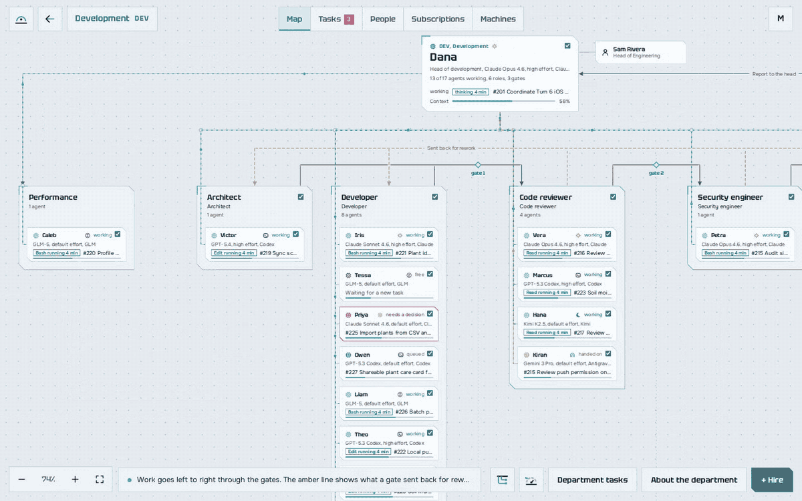
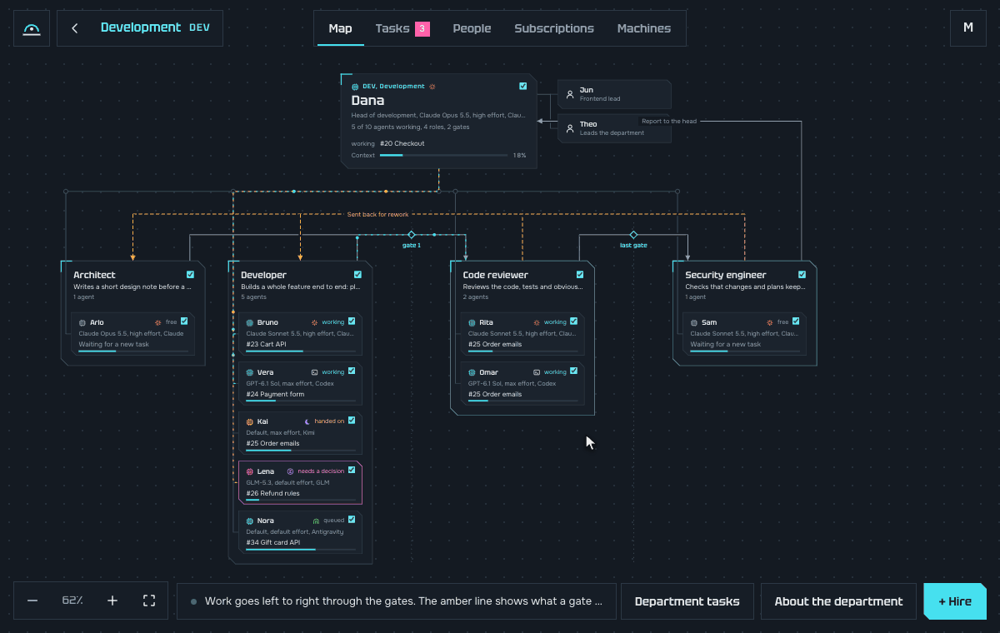

# Departments and employees

> In short: click a department on the map to fly into it and see what each employee does right now. Click an employee to open its window, its terminal and its card. A tick switches an employee, a head or a whole role off for a while.

## What does a department show?

Click a department to fly into it. Its schema shows:

- the head on top;
- a frame for each role;
- work going left to right through the gates;
- an amber line for what a gate sent back.

Every employee shows the task it is about and what it does now: working, queued, handed on, needs a decision, or free.

"Tree" shows the work of the current turn. It opens at 100% from its start, and each employee's name, role, task and state show in full however many employees there are: a long task title wraps, and the tree may be wider and taller than the screen. Drag it with a mouse or finger, use the wheel to zoom, or use the same zoom and "Show everything" buttons as on the map. The tree is for viewing only. Click an employee's name or any of its task rows to open its window, including when it is sleeping.

On the map, a department's card has one square per employee, in the same colors.

## Where are a department's tasks and people?

"Department tasks", "About the department" and "Speed" open at the same place on the left. Task details and employee settings also open on the left. The right side is for the employee's window.

## Hire employees

"+ Hire" asks the orchestrator to staff the department. He proposes people, each with a role, a subscription and a model, and "Hire (2)", with the number of people ticked, creates them.

When he cannot answer, the card comes from the department's default roster. Roles and their skills come from the templates in `templates/`.

## Who is always in Operations?

Every company has Operations, with its head, a task watchdog, a weak point collector and a program operator. Hornhoof hires whoever of the four is missing by itself, when the company is set up and after an update. It leaves everyone else in the department as they are.

On a staff card for Operations these four stay ticked. Someone who already holds the role is shown by name and is not hired again.

The last employee in each of the four cannot be removed. Switch it off for a while instead, or hire a replacement first. A department has one head, so its head has no replacement: change its model or its instructions, or switch it off.

The program operator starts on the oldest subscription that may serve Operations. When there is none yet it waits, and the first that may serve Operations goes to it without a question, even one still waiting for its machine. A subscription you pick for it yourself stays as long as it may serve Operations. When it no longer may, the operator moves to the next one after its current turn ends.

## What is in an employee's window?

Click an employee to open its window, with its terminal or its log. A small mark next to its name says whether it works in Claude, Codex, Kimi, GLM or Antigravity.

"Card" in the window shows:

- where the employee runs, and on which model;
- every subscription and key that may serve its department;
- its skills, as a checklist;
- its prompt, by skill or as the raw text it receives.

Any change applies from the employee's next turn. The card keeps who made it and when.

## Watch and type into an employee's terminal

An employee on a personal Claude Code, Codex, Kimi Code or Antigravity plan works in its own terminal session, on its owner's machine. Its window shows that session live, as the program draws it.

The plan's owner can type into it as into any terminal:

- A line sent there becomes a turn of the conversation, with Hornhoof's tools.
- Escape stops it, as it stops the program.
- Only a line a person sent from this window opens such a turn. The agent's program cannot open one for itself.

Opening the window of an employee whose program does not run starts it, so the owner can type to it at once.

Everyone else who reaches the employee watches the terminal and writes in the line under it, whoever's plan it runs on. The message goes in their name and with their rights. The CEO and the CEO delegate write this way to the orchestrator too, and a person with a department to its employees. Someone without access to an agent sees neither the window nor the line, and the server turns them away.

"Log" shows the conversation as Hornhoof keeps it, and "Stop" ends the running turn. Employees on company API keys show the log.

## How does Hornhoof follow Antigravity?

Antigravity runs its own screen too. Hornhoof reads its hooks and conversation transcript to show answers and steps.

A line typed while it works goes after the running turn.

## Switch an employee off for a while

The tick on each employee, and on the head, switches it off for now, without opening it.

- An employee that is off ends the turn it runs, then takes no task turns until it is on again.
- People can still write to it.
- The work it was doing goes back to its head, who gives it to someone who is on.

The tick on a role's frame switches all of its employees off or on at once.

## How does the head share out the work?

The head spreads tasks over the implementers that are on, a different task for each.

## How do reviews at a gate work?

Reviewers of different models find different things. So at each gate, one employee of the gate's role for each maker of models checks the same work at once, such as one on Claude and one on Codex. For each maker, it is the employee that is on with the fewest tasks at a gate.

- The gate passes when all of them pass.
- A send-back gives the executor all their reasons in one list.
- Work handed in again goes straight back to that gate, and only to the reviewers who sent it back. Each of them checks the fixes for its own findings.

## What if a role has nobody switched on?

- A role with nobody on takes no part. It gets no tasks, and work passes its gate by, on to the next one, or is done after the last.
- A gate whose role has people on, but none who can check it, waits with the head and says who they are. That happens, for example, when they have no subscription. It starts again once one of the role who is on can check it, or when the head gives it other gates.
- A department whose head is off, or whose employees are all off, gets no work from the orchestrator.

## Who sees which departments?

Each person sees the whole company, or the departments and teams ticked for them. Someone who reaches more than one department shows next to the CEO on the map, as a deputy.

[Back to the guide](README.md)
