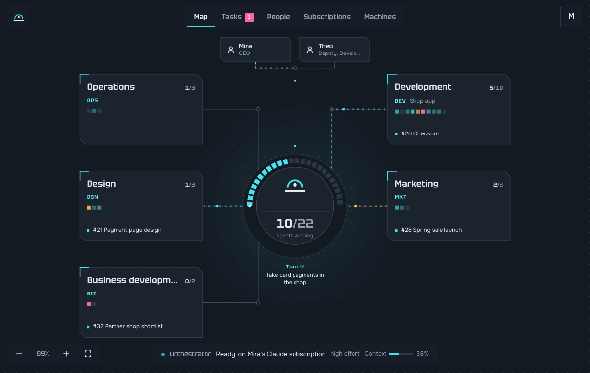

# Departments and employees

> In short: click a department on the map to fly into it and see what each employee does right now. Click an employee to open its window, its terminal and its card. A tick switches an employee, a head or a whole role off for a while.

## What does a department show?

Click a department to fly into it. Its schema shows:

- the head on top;
- a frame for each role;
- Development work going left to right through Architecture, Development, Review, Security and Tests;
- the actual current stage owner and candidate, with findings recorded by the stage that found them. Cleanup appears after Review only when the head enables it.

Every employee shows the task it is about and what it does now: working, queued, handed on, needs a decision, or free.

"Tree" shows the work of the current turn. It opens at 100% from its start, and each employee's name, role, task and state show in full however many employees there are: a long task title wraps, and the tree may be wider and taller than the screen. Drag it with a mouse or finger, use the wheel to zoom, or use the same zoom and "Show everything" buttons as on the map. The tree is for viewing only. Click an employee's name or any of its task rows to open its window, including when it is sleeping.

On the map, a department's card has one square per employee, in the same colors.

## Where are a department's tasks and people?

"Department tasks" opens the Tasks tab at this department, with its goals, pipelines and work. "About the department" and "Speed" open at the same place on the left. Task details and employee settings also open on the left. The right side is for the employee's window.

## Hire employees

"+ Hire" asks the orchestrator to staff the department. He proposes people, each with a role, a subscription and a model, and "Hire (2)", with the number of people ticked, creates them.

When he cannot answer, the card comes from the department's default roster. Roles and their skills come from the templates in `templates/`.

## Who is always in Operations?

Every company has Operations, with its head, a task watchdog, a weak point collector and a program operator. Hornhoof hires whoever of the four is missing by itself, when the company is set up and after an update. It leaves everyone else in the department as they are.

On a staff card for Operations these four stay ticked. Someone who already holds the role is shown by name and is not hired again.

The last employee in each of the four cannot be removed. Switch it off for a while instead, or hire a replacement first. A department has one head, so its head has no replacement: change its model or its instructions, or switch it off.

The program operator starts on the oldest subscription that may serve Operations. When there is none yet it waits, and the first that may serve Operations goes to it without a question, even one still waiting for its machine. A subscription you pick for it yourself stays as long as it may serve Operations. When it no longer may, the operator moves to the next one after its current turn ends.

When a program does not record the words it was given for a minute, the operator gets a turn on any connected machine of its subscription, even if it has never had a turn before. If nobody gets the words through, they are not lost: they go with that employee's next turn, after a wait that grows from one minute to ten, and they are not repeated if the program recorded them after all. However many tries fail in a row, the news comes once. When it is the orchestrator's program, the orchestrator gets no turn about it: you see it in the orchestrator's window, with a picture of its screen, and the head of Operations hears of it.

## What is in an employee's window?

Click an employee to open its window, with its terminal or its log. A small mark next to its name says whether it works in Claude, Codex, Kimi, GLM or Antigravity.

Minimize a window and it waits as a strip at the edge of the screen, with the agent's name and state, on every screen. Opening another agent does the same to the window you had open, so any number of strips can stand one after another; on a phone they stand in a row at the bottom. Click a strip to bring its window back as you left it. Only its cross closes it. An agent has one window, so opening the same agent again brings back its strip. Strips last until you reload the page.

"Card" in the window shows:

- where the employee runs, and on which model;
- every subscription and key that may serve its department;
- its skills, as a checklist;
- its assignment, separately from its role identity, saying why it exists and which work it owns;
- its prompt, by skill or as the raw text it receives.

Any change applies from the employee's next turn. The card keeps who made it and when.

## Watch and type into an employee's terminal

An employee on a personal Claude Code, Codex, Kimi Code or Antigravity plan works in its own terminal session, on its owner's machine. Its window shows that session live, as the program draws it.

The plan's owner can type into it as into any terminal:

- A line sent there becomes a turn of the conversation, with Hornhoof's tools.
- Escape stops it, as it stops the program.
- Only a line a person sent from this window opens such a turn. The agent's program cannot open one for itself.

Opening the window of an employee whose program does not run starts it, so the owner can type to it at once.

Everyone else who reaches the employee watches the terminal and writes in the line under it, whoever's plan it runs on. The message goes in their name and with their rights. The CEO and the CEO delegate write this way to the orchestrator too, and a person with a department to its employees. Someone without access to an agent sees neither the window nor the line, and the server turns them away.

"Log" shows the conversation as Hornhoof keeps it, and "Stop" ends the running turn. Employees on company API keys show the log.

## Show an employee a picture

Drag a picture into the window of the orchestrator or of an employee, or paste it with Cmd+V or Ctrl+V. The picture button by the message line picks one from your files, on a phone too. It works with the terminal and with the log. Whoever may write to the employee may send it a picture; the server turns away anyone else.

- A small preview waits at the line, and its cross takes the picture back. The owner of the employee's plan, who types into the terminal, gets the line for as long as a picture waits in it.
- One message carries up to 10 pictures, with words or without them.
- A picture is a PNG, JPEG or WebP of at most 3 MB. Your browser first makes a bigger one smaller. Anything else is turned away, and the window says why.
- The employee reads each file's name and the command that downloads it, `hh-fetch message ID`, in any program. Only that employee can download it.
- The log shows the picture next to your message, for everyone who can open this window, and a click opens it large. The terminal shows only the words. Hornhoof keeps a picture for 30 days.

## How does Hornhoof follow Antigravity?

Antigravity runs its own screen too. Hornhoof reads its hooks and conversation transcript to show answers and steps.

A line typed while it works goes after the running turn.

## Switch an employee off for a while

The tick on each employee, and on the head, switches it off for now, without opening it.

- An employee that is off ends the turn it runs, then takes no task turns until it is on again.
- People can still write to it.
- The work it was doing goes back to its head, who gives it to someone who is on.

The tick on a role's frame switches all of its employees off or on at once.

## How does the head share out the work?

The head spreads tasks over the implementers that are on, a different task for each.

## How does Development review work?

Each executable task passes Review with one current owner. The reviewer checks errors, clarity and basic security, repairs its findings in the same task branch, then passes the final candidate forward. Security does the same deeper check when the task's risk requires it. Work that solves the wrong problem goes to the head for a decision.

The checker must use a model at least as capable as the producer's. Hornhoof prefers an eligible different provider when one is available. A single provider, subscription or tariff is allowed; the task does not wait for a second provider solely for that reason. Unknown model capability needs the head's attention.

Cleanup is optional and off by default. When the head enables it for a task or turn, it follows Review and uses the existing dev-cleanup skill. Tests checks the exact final candidate after all repairs. Findings retain their stage and candidate history; they are counted once.

A department's sub-unit can be marked "Works turnkey" on the department's screen. Each of its members then does a task alone from start to finish: code, checks, tests, merge and release. Such a task goes through no stages, and nobody else in the department checks it, whatever its text says. The mark holds for tasks given from then on. The turnkey team a department's template brings gives each member the skills of every check of that department, as the member does them alone.

## How is work checked in the other departments?

Every department has a route of its own: the stages its work goes through in a turn that runs in stages. Development has the longest one. In Marketing, Sales, Support, Business development, Design and Finance a task is done by one employee and checked by another before the head accepts it. In Operations a fix is checked by another engineer and then run in the test environment, where the department keeps code. Home devices and Household have no check: one helper does the work, and anything that acts on the real world waits for a person.

| Department | Who checks |
| --- | --- |
| Marketing | Editor |
| Sales | Sales reviewer |
| Support | Support quality reviewer |
| Business development | Research reviewer |
| Design | Design QA |
| Finance | Finance auditor |
| Operations | Reliability engineer and Integrations engineer, each the other's work |

The one who checks carries the skill "Checking a result" and runs a model at least as strong as the author's. It corrects what it finds itself and passes the result on, or sends work that answers the wrong question to the head.

A department that keeps its work in a repository hands in a commit, as Development does. A department with no repository hands in a document until it gets one: what the employee wrote in the hand-in and the files attached to the task. [Repositories](repositories.md#why-does-every-department-need-one) says why it should get one. The task shows its stages as "Work" and "Check", and once the check passed it waits for the head to accept it.

A department where nobody carries the checking skill works as before: the employee does the task and reports it done. To have work checked there, hire the role from the table or switch the skill on for an employee. Outside a turn, and in a turn that runs turnkey, there are no stages in any department.

## How hard does an employee think?

Hornhoof picks the configured level when a turn starts. It stays until that turn ends.

- Every echelon, including repairs by its current owner, runs at the role's level or the level set on the employee's card.
- Review and Security fix their findings in the same task and branch. Findings do not lower their level or send the work back to its author.
- The selected model's supported levels bound the role default. An explicit card choice stays on the card.
- With no configured level and no known model levels, Hornhoof leaves the program to choose.
- A change of level starts the program again between turns, and the conversation goes on in the same session.
- Words a person types into a running program start no program and change no level. They run at the level the program already has.

### Which programs, models and levels fit a role?

Hornhoof's own lists give these tables, so they say what it does today. A program that lists no models here shows what it has once its machine reports it. OpenRouter and a compatible API run the models named for their connection. A model that lacks a level gets the nearest one it has.

| Program | Models | Levels | Deep roles |
| --- | --- | --- | --- |
| Claude Code | Fable, Opus, Sonnet, Haiku | low, medium, high, xhigh, max | yes |
| Codex | what its machine reports | what its machine reports | yes |
| Kimi Code | what its machine reports | what its machine reports | no |
| GLM | what its machine reports | what its machine reports | no |
| Claude API | Claude Fable 5.1, Claude Opus 5.5, Claude Sonnet 5.5, Claude Haiku 5.5 | low, medium, high, xhigh, max | yes |
| OpenAI API | GPT-6.1 Sol, GPT-6 Astra, GPT-6.1 Terra, GPT-6 Sol, GPT-6 Luna | low, medium, high, xhigh, max | yes |
| Antigravity | what its machine reports | what its machine reports | yes |
| OpenRouter | what its connection names | what its connection names | yes |
| Compatible API | what its connection names | what its connection names | yes |

| Level of the role or card | Every echelon, including repairs |
| --- | --- |
| low | low |
| medium | medium |
| high | high |
| xhigh | xhigh |
| max | max |

| Department | xhigh | high | medium |
| --- | --- | --- | --- |
| Business development | - | Business analyst, Research reviewer | Head of business development, Partnerships manager, Product manager |
| Design | - | Design system designer, Product UI designer | Design QA, Head of design, Product manager |
| Development | Architect, Backend engineer, Code reviewer, Developer, Frontend, Performance engineer, Red team, Security engineer | DevOps engineer, Head of development, QA lead, Test engineer | Product manager, Technical writer |
| Finance | - | Finance auditor, Financial planning analyst | Bookkeeper, Controller, Product manager |
| Home devices | - | Home network helper | Head of home devices, Product manager, Smart home helper |
| Household | - | - | Bills helper, Calendar helper, Head of household, Product manager, Supplies helper |
| Marketing | - | Copywriter, Editor | Head of marketing, Product manager, Search specialist, Social media manager |
| Operations | - | Integrations engineer, Reliability engineer, Weak point collector | Accounts administrator, Head of operations, Product manager, Program operator, Task watchdog |
| Sales | - | Account executive, Sales reviewer | Head of sales, Product manager, Sales development representative, Sales operations analyst |
| Support | - | Second-line support, Support quality reviewer | First-line support, Head of support, Knowledge base editor, Product manager |

Each role asks for a strength of model, and an employee hired without a model named runs the one of that strength its plan has, by name. When the plan has none of that strength it takes the nearest stronger one, else the nearest weaker.

Top roles, the strongest model there is, for work nobody checks after: Architect, Security engineer.

Deep roles, a strong model, for whoever checks the work of others or leads risky work: Code reviewer, Controller, Design QA, Editor, Finance auditor, Head of business development, Head of development, Red team, Research reviewer, Sales reviewer, Support quality reviewer.

Fast roles, the lightest model, for simple work that comes in a stream: Calendar helper, First-line support, Product manager, Sales development representative, Social media manager, Supplies helper, Task watchdog.

Every other role takes the middle one: its work is checked after.

## What if a role has nobody switched on?

- A role with nobody on receives no new assignments.
- A required Development stage with no eligible owner waits for the head. Review and required Security are never skipped because a role is off, a model is weaker or a subscription is unavailable. The head can assign an eligible employee with the stage's check and repair skills.
- A department whose head is off, or whose employees are all off, gets no work from the orchestrator.

## Who owns a department's approvals?

A department can have an owner: a person the CEO names under **About the department**, from the people with access to it. With no owner, the CEO decides. Having access never makes someone the owner, and Hornhoof never works it out on its own.

The owner receives the department's approval requests. The people who run the department can set a rule for messages, prices, publications, commits, spending or other work. They can also set it through their head. The CEO, the delegate and the orchestrator acting for the owner can set these rules too. Each channel has four modes.

- **Every one to me**: each one asks.
- **Only new kinds**: a kind of work asks until someone approves it once. A declined kind asks again.
- **No approval within limits**: up to the limit nobody is asked and the task's log keeps a line about it. Above the limit, or when the work does not say how much, the owner is asked.

- **No approval**: work goes ahead without a request.

A channel with no rule needs no approval. People can set a rule even if the department already works on that channel. A person pays money or signs in the company's name. The rules stay with the department when its owner changes. If the owner loses access or is switched off, the CEO takes the approval requests again.

The CEO and the CEO delegate can always answer any request themselves, but a department's approvals no longer add to the CEO's count once it has an owner. The head brings the CEO in when the department misses a goal or its plan.

The commit rule covers main acceptance and release. For **Only new kinds**, exact commits share one kind. For **No approval within limits**, an exact commit has no amount, so the rule calls for approval. [Tasks and turns](tasks-and-turns.md#who-approves-what-reaches-the-main-branch) explains the evidence for either route.

## Who sees which departments?

Each person sees the whole company, or the departments and teams ticked for them. Someone who reaches more than one department shows next to the CEO on the map, as a deputy.

[Back to the guide](README.md)
