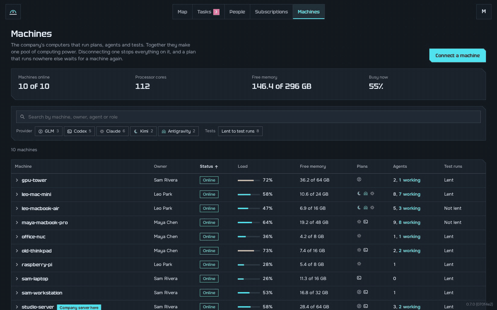

# Tests and heavy work on free machines

> In short: an agent checks its change in its own workspace, including installs, named test files, types, lint, builds and quality checks. The checks of a task that need more machines run through `run_tests`, split into groups over free machines. A release does not use it: it relies on the repository's own CI. Other non-check work can use `run_work`. Only machines lent to test runs take this work, and a loaded one takes none.

The names in `code`, like `run_tests` or `pool`, are tools the agents use. You do not type them.

## Where do the tests run?

An agent runs the checks of a task with `run_tests`, only on `main`, a turn's branch or a `release-` branch: the files of its change and the tests selected for them. A release is not checked this way. It is recorded on the repository's own CI for the exact commit, which Hornhoof reads from the repository's host, or with no run where the repository has no CI. Hornhoof sends the run to whichever machine of the company is freest at that moment, while the agents keep working where they are. On any other branch, a task's own above all, `run_tests` starts nothing: an agent checks its change right away in its own workspace, by local tests of what it touched. Install from the lockfile once there, and again when it changes. A test command with no named files, or with a directory, glob, loop or variable as its selection, counts as a whole suite. Named browser test files run locally when the browser is there; installing it is allowed.

A test runner that can split a suite runs it in parts, one part on each of several machines at once.

Before the first part goes out, Hornhoof reads from the repository the exact commit the branch is at. Every part tests that commit, even when someone pushes to the branch meanwhile, and the result names it. A part that tested another commit fails the whole run. The server itself reads this over https, so it must be able to reach the repository: when it cannot, the run does not start and the agent is told why.

## What does the Machines tab show?

Machines shows the company's machines as one pool: how many are online, their processor cores, their free memory and how busy they are now.

Each machine's card adds:

- its owner, system, processor, memory, load and free disk;
- its plans;
- the employees and test parts on it now.
- when it waits for its work to end before an update, how many turns are left and until when.

On a Mac, Docker runs in a smaller system of its own. So the card shows what Hornhoof can use there, and says when that is less than the Mac has. What a node of an older build does not tell shows as unknown.

## Is the server's own machine counted twice?

No. When the server runs on a machine that also joined, the installer tells the server which one, by a hash of that machine's key, never the key itself. So Machines and the pool count that machine once, and the built-in node's card names it.

A server installed before that counts its built-in node apart, as before.

## Which machines take a test run?

A machine takes a test run when all of these are true:

- it is a computer;
- it is online;
- it is lent to test runs;
- its node has a free test user;
- its physical computer has enough free memory and cores after accounting for the parts it has already taken;
- its owner reaches the department whose repository is tested.

The built-in node takes test runs too. A run needs 4 GB of free memory, unless the repository's settings name another amount.

The ordinary and built-in nodes on the same physical computer share its memory and cores. The newest host report supplies
its free memory and the cores left by its load. Each part reserves the memory its repository asks for and the cores its
workers use. A part must also fit within its node's own memory limit, such as a container's limit. Parts on the same node
take turns because they share one system user. An assigned part keeps its reservation through a lost connection or server
restart until the part ends or is declared lost.

The pinned test environment can name a worker count, as Hornhoof's browser suites do. For Vitest without a pinned count,
Hornhoof allows 2.5 GB per worker and 1 GB for Vitest itself within the part's memory budget, with at least one worker.
The node runs Vitest with that limit.

To set an upper limit on concurrent parts per physical computer, set `MAX_RUNS_PER_HOST` to a whole number from 1 to 1000
and restart the server. With Docker Compose, put it in `.env`. An empty setting leaves admission to memory, cores and
the available test users.

## Keep your machine out of test runs

Every machine is lent at first. Its owner, or someone who sees the whole company, takes it back with the tick on the machine's card, "Lend to test runs".

## What if no machine is free?

The run waits, and starts on the first machine that frees up. A part that finds none within 2 hours ends.

Once a test part starts, new output or progress restarts its quiet timer. Hornhoof allows one and a half times the
estimated duration of the part plus one minute, or one hour when it has no recorded times. At the end of that quiet
period, the node alerts Operations and stops the part. Set `minutes` in `run_tests` to impose an upper time limit on
each part, including parts still making progress.

## What happens on the machine during a run?

1. The branch is cloned into a fresh folder.
2. The command runs in it as a user that reaches neither the node's key nor the agents' folders.
3. It runs for at most 30 minutes, unless the agent asks for up to 120.
4. The folder is removed.

## How does the agent get the result?

When every part has ended, the agent is woken on its task with the result:

- passed or failed;
- which machine ran each part, and for how long;
- the last lines of what failed.

The whole log of each part goes on the task as a file, like `tests-3-1.log`. `test_run` shows how a run goes, and `stop_tests` stops it.

## Where does the repository token go during a test run?

The repository's token goes along to each machine that takes a run. So it reaches the lent machines of everyone who reaches the department.

## Which nodes take test runs?

- Nodes of an older build say nothing about their load, and get no test runs until they are updated.
- A node takes parts of runs only when it can run them as a user of its own. It can when it runs as root, with the rights to switch users.
- A node that cannot takes none and says why. The orchestrator sees that in `pool`.

## What if a machine goes away during a run?

A part does not move once it runs. The part runs again from the start when its machine:

- restarts;
- is offline for 3 minutes;
- is disconnected;
- loses the plan its node ran for.

It runs again on another machine when one is free for it, at most twice, and the result says where it was lost.

Other work, from `run_work`, is different. A part of it may still run on a machine that went offline, or that was disconnected or lost its plan while away. So it runs again only when `run_work` said `repeatable`, for a command that does no harm if it runs twice. Otherwise it ends, and the result says why.

## Run other heavy work on free machines

Heads and workers run non-check work with `run_work`. It may prepare dependencies, but any check in a work run still goes to `run_tests`. Checks of one's own change stay in one's own workspace:

- With a branch, it runs in a clone of the repository. Without one, it runs in a fresh empty folder.
- The files it names come from the task.
- Whatever the command leaves in its output folder goes on the task, like `work-2-1-report.pdf`.
- A part needs 2 GB of free memory, unless the agent names another amount.

`work_run` shows how it goes, and `stop_work` stops it. Only nodes of a build that knows work take it.

## How does the orchestrator see the pool?

With `pool`. It shows every machine with its owner, its load and the parts it runs, and each part that waits, with why no machine took it.

## Can phones and browsers join?

Not yet. A machine is a computer for now. Phones and browsers will join as machines of their own kind, and take no shell commands.

[Back to the guide](README.md)
