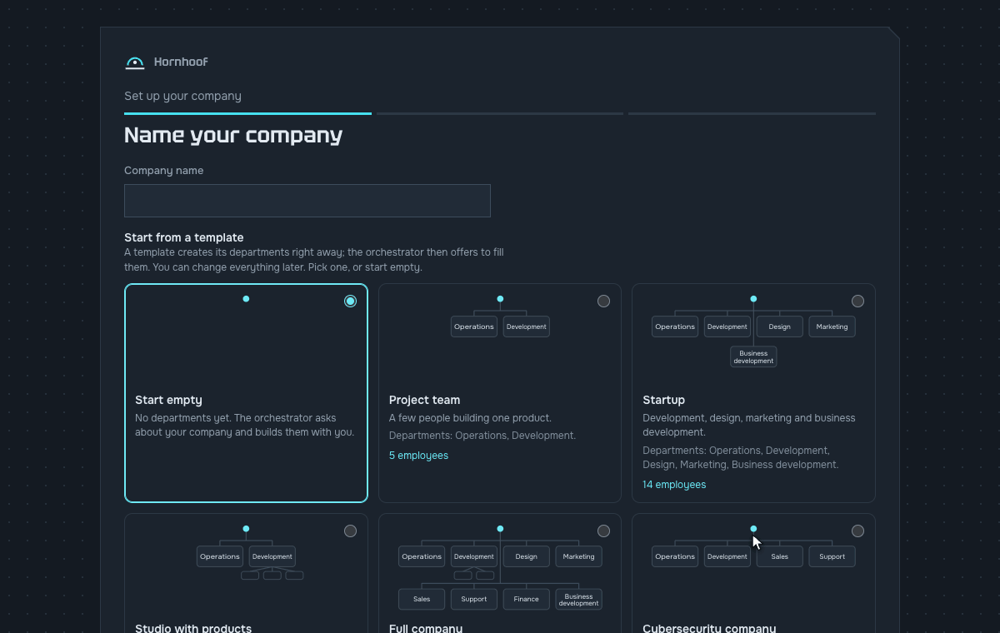

# Install and run the server

> In short: one line in a terminal installs Hornhoof with Docker and shows a link that sets it up. Run the same line again to update. You can also run several companies on one computer, or build Hornhoof from its source.

## What does the install line do?

On a Linux or macOS server, run:

```sh
curl -fsSL https://raw.githubusercontent.com/Invariant0x/hornhoof/main/scripts/install.sh | bash -s -- server
```

It goes through these steps:

1. It installs Docker if it is missing. On macOS that is Colima, through Homebrew. Docker Desktop or OrbStack that is installed but not running, it starts.
2. It puts `compose.yaml` and a `.env` file with fresh secrets into the `~/hornhoof` folder.
3. It downloads the images and starts them.
4. It shows the link that sets Hornhoof up. People get the company's own link later, at setup.



## How do I update it?

Run the same line again. It keeps the existing `.env`. The new server starts at once, and its nodes follow when what they run has finished; with `--urgent` after `server` they go along now, which stops what they run. [Updates](updates.md) says how Hornhoof offers a new version by itself.

## How much of my Mac does it take?

On a Mac, Docker runs inside Colima. A Colima the installer sets up gets all of the Mac's processors and three quarters of its memory. A Colima you set up before keeps the size you gave it.

Docker Desktop and OrbStack keep the size set in their own settings. Docker Desktop starts by itself after a restart only when "Start Docker Desktop when you sign in to your computer" is on, under Settings, General. Without it, your companies wait until you open Docker Desktop.

Every node also gets 2 GB of shared memory for the browsers agents run.

## Run several companies on one computer

Each company is its own Hornhoof. To run a second one next to the first, give it a name:

```sh
curl -fsSL https://raw.githubusercontent.com/Invariant0x/hornhoof/main/scripts/install.sh | bash -s -- server --name acme
```

- It goes into `~/hornhoof-acme`, as its own compose project.
- It takes the first free web port from 8080 and peer port from 8180, and keeps them in `.env` as `HORNHOOF_PORT` and `HORNHOOF_PEER_PORT`.
- It also picks two non-overlapping `/24` Docker subnets outside this computer's own addresses, routes and existing Docker networks, keeps them in `.env` as `HORNHOOF_SUBNET` and `HORNHOOF_INTERNAL_SUBNET`, and records them alongside the ports in the Docker volume `hornhoof-ports`. No two Hornhoof projects on this computer get overlapping ports or subnets, even while one is stopped.
- Run the same command again to update that company.

Machines can carry nodes and cores for several companies too. Each joined core takes its own folder, Compose project, ports and Docker subnets, and each node remembers the address of its Hornhoof. So an update or `--uninstall` from one Hornhoof touches only that company's core and nodes.

## What if machines on the same home network reach each other only through hornhoof.org?

Check whether an older Docker network on one of the computers covers your home network range (for example `192.168.0.0/20` over `192.168.1.0/24`):

```sh
docker network ls
docker network inspect <network>
```

If an older Hornhoof project holds that overlapping network, run the Hornhoof install command again on that computer: the installer picks free subnets outside the home network and recreates the project's network cleanly. If an unused network from another Docker project holds that range, remove it with `docker network rm <network>` after stopping what uses it.

## Run it from source with Docker

You need Docker with Compose.

```sh
git clone https://github.com/Invariant0x/hornhoof.git
cd hornhoof
echo "HORNHOOF_SECRET=$(openssl rand -base64 32)" > .env
echo "NODE_KEY=$(openssl rand -base64 32)" >> .env
echo "POSTGRES_PASSWORD=$(openssl rand -hex 24)" >> .env
docker compose up -d --build
```

Without `HORNHOOF_SUBNET` and `HORNHOOF_INTERNAL_SUBNET` in `.env`, `compose.yaml` falls back to `10.200.0.0/24` and `10.200.1.0/24` (set distinct `/24` ranges in `.env` if your network uses `10.200.0.x` or you run a second source checkout here); on an existing install whose network configuration hash changes when explicit subnets are added, older Compose 2.20+ releases may ask for one `install.sh` run by hand.

Hornhoof writes a setup link to its log, like `http://localhost:8080/setup?code=...`. Find it with `docker compose logs app`, or print it with:

```sh
docker compose exec app node apps/server/dist/cli.js setup-link
```

Open the link and follow the setup: name your company, create your account and connect the orchestrator's subscription.

Until a company is set up, only that link sets it up. So nobody else who reaches the port first can make the company their own.

## What in `.env` must I keep safe?

Keep `.env` safe. Here is what its secrets do:

- `HORNHOOF_SECRET` encrypts the API keys stored in the database. Without it they cannot be read back.
- `NODE_KEY` lets the built-in node connect to Hornhoof. The built-in node runs the company's API keys.
- `POSTGRES_PASSWORD` becomes the database's password when the database is first made. Keep it as it is afterwards.

## How do people open it from other computers?

The simplest way is a link at hornhoof.org. [The link on the internet](public-link.md) describes it.

To use your own domain instead:

1. Put `https://your.domain` into the `PUBLIC_URL=` line of `.env`. The installer writes this computer's own address there, like `http://localhost:8080`.
2. Put something that handles TLS in front of Hornhoof, like Caddy, nginx or a Cloudflare tunnel. Hornhoof itself serves plain HTTP.

Invite links and the node command use this address. Sign-in cookies are marked secure when it starts with `https://`. Without TLS the browser drops the secure cookie, and you stay on the login screen.

## Where do errors go?

To the container log. Run this next to `compose.yaml`:

```sh
docker compose logs app
```

## What if the owner forgets the password?

Run this next to `compose.yaml`:

```sh
docker compose exec app node apps/server/dist/cli.js owner-link
```

It prints a one-time link that works for 7 days and sets a new password. The old password and open sessions stop working at once.

## How do I remove it?

- **From a connected computer:** run `curl -fsSL <your Hornhoof address>/install.sh | bash -s -- --uninstall`. It lists this
  company's nodes on that computer and removes them once you say yes, with the company's core there if it has one. Their
  volumes, with the sign-ins and work files, are deleted only if you say yes again.
- **The server:** run the public install command at the top of this page with `--uninstall` in place of `server`.
  For a named installation, use `--uninstall --name <name>`. Confirm the folder shown by the installer. It verifies a
  database archive before removing the Docker project and keeps the archive, database roles, and installation settings
  together in the private backup folder it prints.

[Back to the guide](README.md)
