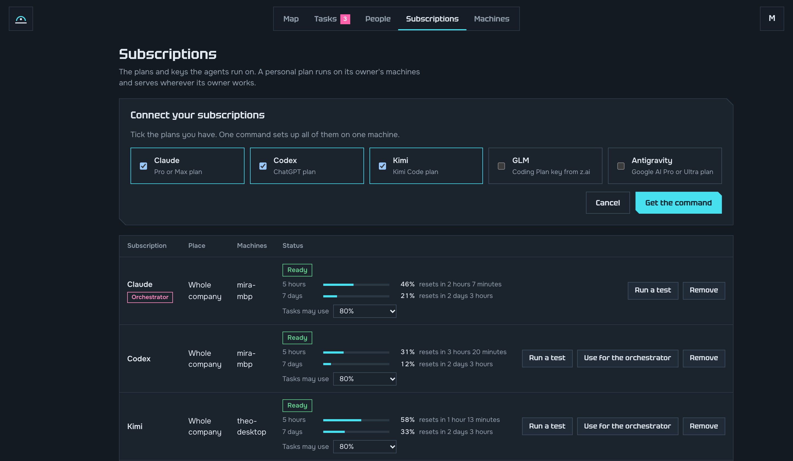

# Machines and plans

> In short: agents run on machines that hold the AI plans. You connect a plan with one command on your own computer, and its sign-in never leaves that computer. A machine can also join with no plan, just to lend itself to test runs.

## Where do agents run?

Agents run on machines that hold the subscriptions.

- Company API keys run on the built-in node that comes with the server.
- A personal plan runs on its owner's machines, and only on Linux or macOS.

## Connect your plans

1. Open Subscriptions and click "Connect a subscription".
2. Tick the plans this machine will carry, click "Get the command" and copy it.
3. Run it in a terminal on that machine. The command works once, for 24 hours.

The command installs Docker if needed, starts one small locked-down container per subscription and signs each one in:

- Claude opens the claude.ai login for your Claude plan.
- Codex opens the ChatGPT device login for your ChatGPT plan.
- Kimi opens the Kimi Code login.
- GLM asks you to paste your GLM Coding Plan key from z.ai.
- Antigravity, Google's agent program for a Google AI Pro or Ultra plan, opens the Google sign-in. Google then shows a code: paste it into the terminal where the command runs.

## What can agents use on a machine?

Every node carries git, ripgrep and a headless Chromium with Playwright, so agents can open and check web pages. Anything else they need they install into their own folder.

## Who can give work to my agents?

Agents will run on that machine with your subscription. People with access to this Hornhoof can give them work.

## How are agents kept apart on one machine?

Inside its container the node runs as root, and its agents run as a user of their own. That means:

- no agent reads the node's key or changes its programs;
- no agent types into another agent's terminal;
- the node takes a tool call only from the program of the agent it belongs to.

Agents that share one subscription still share that user and its sign-in. So they can read each other's folders and the repository tokens they work with. Give departments whose work must stay apart subscriptions of their own.

## Update or remove the nodes on a machine

- To update the nodes on a machine later, run `curl -fsSL <your Hornhoof address>/install.sh | bash` on it.
- To remove them, end the same command with `bash -s -- --uninstall`.

## Can a machine join without a plan?

Yes. Open Machines, click "Connect a machine" and run the command on that machine.

It starts one container with nothing to sign in to. The machine lends itself to the company's test runs like any other machine. Machines lists it as its owner's, with no plan.

## Add a plan to a machine that already joined

The owner clicks "Add my plan" on the machine's card. That gives a command for this machine only. It starts the plan's node there and signs it in there, because sign-ins never travel between machines.

One plan can run on several machines of its owner this way.

## Which machine does an employee work on?

- An employee stays on the machine it started on while that machine is online and signed in. So it keeps its folder, session and terminal there.
- A new employee, or one whose machine went away, starts on whichever machine of its plan its nodes say is freest. Among machines about as free, it takes the one with the fewest agents.
- Such an employee starts in a fresh session that catches up from the conversation.
- The employee's card shows the machine it works on.

## What happens when I disconnect a machine?

Disconnecting a machine stops everything on it. A plan that runs nowhere else waits for a machine again.

## Can the orchestrator make these commands?

Yes, when the CEO asks. The command then shows on the CEO's screen, as a card in the orchestrator's window. The orchestrator itself gets only a line saying that it is there.

The command's code never reaches an agent, its terminal or its conversation. A conversation that holds such a command keeps it with the code hidden.

## What happens when a plan hits its limit?

A plan at its usage limit holds its agents' turns until the limit starts over, and their tasks go on after it. An agent's turn is one round of its work: [Tasks and turns](tasks-and-turns.md#what-is-a-turn) explains it.

- A task an employee on that plan was doing goes instead to another employee of the same role in the department. That employee must be switched on and work on a plan of another provider that is not at its limit. The task gets one note about the move.
- Heads and the orchestrator wait for the reset.

Hornhoof learns about the limit from the plan's own figures, or from the error its program prints, like Kimi's 429 or Codex's "hit your usage limit". A program that names no time is tried again every quarter of an hour.

## Keep part of a plan for yourself

Next to each plan's limits, "Tasks may use" sets the share of every limit window that task turns may spend: from 50 to 90 percent, or the whole limit.

Past that share, task turns wait for that window to start over. Messages from people still go.

[Back to the guide](README.md)
