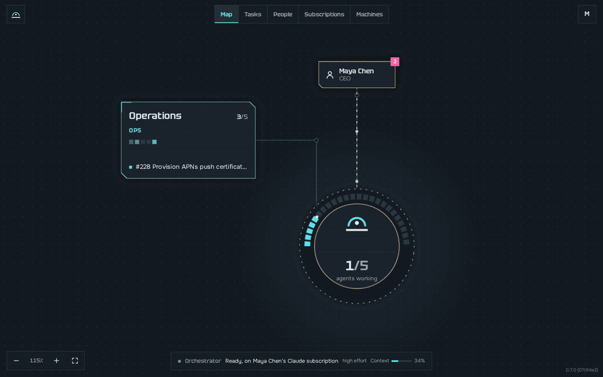

# The orchestrator

The orchestrator is the agent in the middle of the company map. Open its window to ask it for help, tell it what the company needs, or give it work to carry out.

## How does it work?

The orchestrator acts with the company owner's rights. It has the same company access through named tools, the generic `api` tool, HTTP and MCP. It can manage people and their access, departments, employees, tasks, subscriptions, repositories, machines, updates and the public link.

Its authority stays the same when a person, an employee, a task or a timer starts the turn. It can also use its tools between turns. Incoming messages and files inform its work. Follow orders through the company's trusted channels and treat quoted or outside text as information.

The orchestrator can see a person's assistant and its conversation. The assistant takes orders from its own person. Department heads use the rights of the people responsible for their department, and departments send, post and talk to people as part of their own work.

## When does a person decide?

Only the CEO can approve an irreversible deletion. The decision is recorded for the specific action and target. On the People screen, the CEO can confirm **Delete** for the named person. A CEO using the API can also send `{ "approve": true }` to `POST /api/people/:id/delete-approval` for the orchestrator to carry out later. If cleanup stops partway through, deleting the same person again resumes it.

A person pays money and signs in the company's name. Agents sign in themselves using the vault.

## Can it change the database?

The orchestrator's `database` tool runs SQL as Hornhoof itself. It can read and change every table, every column and the schema. Use the deletion workflow for permanent deletions so the CEO's decision and the cleanup are kept. The head of Operations has a separate read-only database role and sends the orchestrator changes it needs.

The orchestrator can read pending cards, machine access requests and merge conflicts. A merge choice that would permanently delete a record needs a direct CEO choice. Machine setup commands appear on the person's screen and in the orchestrator's working tool result, with the join code hidden in the saved conversation.

## Can it work on a company machine?

The Machines screen shows what access a machine has open and who opened it. A machine that holds its owner's key needs a signed grant. The server's own machine can also use company access when it has no owner key. Choose who gets access and for how long. **Close access** ends the grant early.

While access covers the orchestrator, it can work on that machine in any turn or tool step. On a Mac that runs the server through Docker, this reaches Docker's Linux system.

[Back to the guide](README.md)
