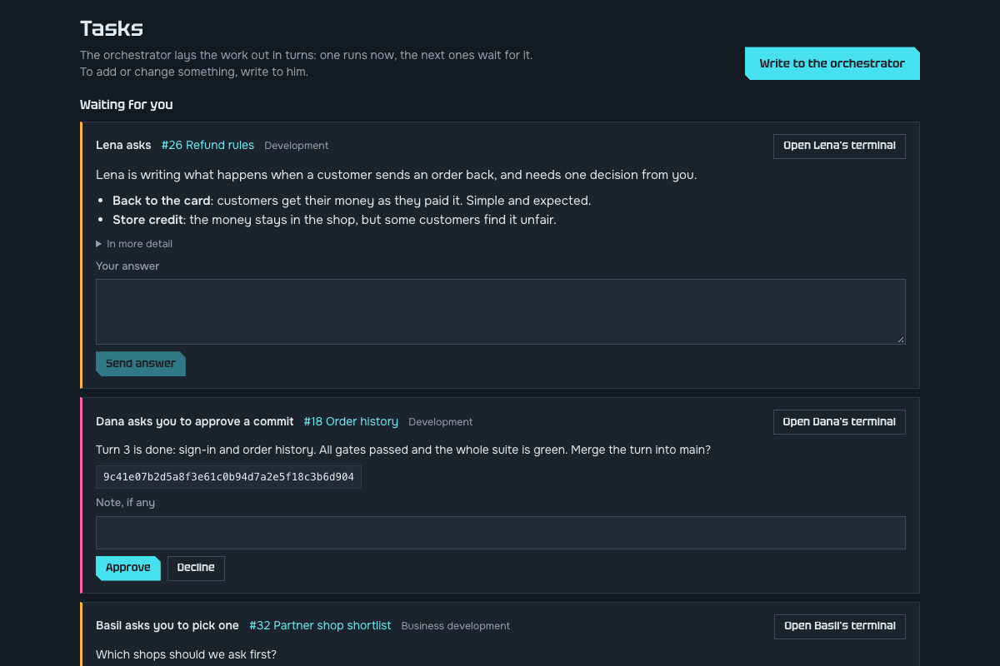

# Tasks and turns

> In short: you write to the orchestrator, and he lays the work out as tasks, grouped in turns. One turn runs at a time, and each department's head keeps connected work with one owner and splits off only the parts that are truly independent, each passing only the checks it needs. Nothing reaches the main branch until a person approves the exact commit.



## What is a turn?

The word has two meanings in Hornhoof.

- A turn of the company is a batch of work, like turn 3. Tasks come in these turns.
- An agent's turn is one round of an agent's work, from the moment Hornhoof wakes it until it stops. The parts about waking agents, from "When does Hornhoof wake an agent?" on, count these.

## Where do tasks come from?

Work moves as tasks, and tasks come in turns. Nobody fills the tracker by hand: people write to the orchestrator, and he lays the work out.

A turn has:

- a short title;
- its main point;
- one task for each goal the CEO gave it, whole, for the department that owns it.

The people's own words it came from open on a click.

## What does the Tasks tab show?

From top to bottom:

1. What agents wait for from people: questions to answer, commits to approve, and tasks an agent got stuck on.
2. The running turn, with its tasks.
3. The planned turns, in order.
4. The finished turns, folded away.

## What happens when I add work while a turn runs?

One turn runs at a time. When the orchestrator lays out a turn while one runs, it waits as planned, with its tasks planned too.

When people add to the work, he puts it into the next planned turn, or into a new turn after them. It goes into the running turn, where it starts at once, only when the CEO says now. He says where it went.

## How does a department split its task?

Each task of a running turn goes to its department's head. The head gives it out at once. Connected work stays with one owner, only truly independent parts go to different people, and a whole task can go to one developer.

In Development, each piece is a whole feature for one developer of the pool. When the feature is new or large, an architect writes a short design note first.

## Which checks does a piece go through?

Development uses one route for each executable task:

- Architecture writes the plan when the task is large. Small tasks start at Development.
- Development produces the change and its checks.
- Review checks the work and repairs its findings in the same branch.
- Cleanup runs after Review only when the head explicitly enables it for the task or turn. It is off by default and uses the existing dev-cleanup skill.
- Security checks sensitive work when the head requires it or Review discovers the risk.
- Tests verifies the final candidate, including repairs, using applicable checks and verified results at the same influencing fingerprint. Mutations cover only changed pure functions with fast tests.

Each stage has one current owner. Review is required even when only one provider or subscription is available. The checker must use a model at least as capable as the producer's; an eligible different provider is preferred when available.

A coordination task with no executable result closes with a checked report and valid reviewed child results. An unfinished, unaccepted or stale child blocks that report. A parent that produces its own executable result follows the route above.

## How does a member work its piece?

1. It works the task in a branch.
2. When it cannot go on, it marks the task blocked, which asks its head. The head answers with a comment, and that opens the task again once. If the task comes back blocked after that, the head writes the answer into the task, which opens it again.
3. It hands the task in, with evidence.
4. The current stage owner checks and repairs the same branch, records its findings and exact candidate, then passes the task forward.
5. Tests verifies that final candidate. The authorized head accepts the exact checked result through the task's integration route. Main and release still require the authorized person's approval of the exact commit.

Review and Security keep their own repairs, and nothing goes back to an earlier stage. Work that solves the wrong problem is escalated to the head. A failed applicable check stays visible; an old receipt cannot certify a newer repair.

## When does the head report?

The head hears once, when every task it gave out under its department's task is closed. Then it reports to the orchestrator.

## Can a task wait for other tasks?

Yes. A task can come after other tasks of its turn. It waits, and its member is woken by itself once the last of them is done.

When one of those tasks is cancelled, whoever made the waiting task is told.

## When does a turn end?

Once every task of the turn is closed, the turn ends. The next planned one starts by itself.

## How do I see how a turn went?

Open a department, then "Speed", then "Report", and pick any turn that ran. You see that department's time from issue to acceptance, its critical path apart from the sum of agent hours, time by stage, waits by reason, returns, failures, interrupted turns, numbers by kind of task, quality after release and test time by package and file. Each number comes with its change in percent to the previous turn and to the starting turn: turn 7, or the first turn of a company that never ran one.

Hornhoof saves a turn's numbers as it closes, before the next one opens. A turn closed before this existed is worked out from its events the first time someone reads it, and the report says so. Bugs found later keep counting after that, since they turn up later.

Only people who reach the whole department see its report. The orchestrator reads the same report with `pipeline_report`.

## What are a task's kind and risk class?

The head or the orchestrator can say what kind of work a task is (bug, known behavior, unknown path, legacy code) and what a mistake in it would touch (money, access, security, data or none). They show on the task and in its tools, and the report counts by kind. Changing them wakes nobody and leaves the task where it stands.

## When does Hornhoof wake an agent?

When there is something for it:

- a task given to it;
- work assigned to its current stage;
- a decision or repair assigned by the head;
- an answer from a person.

## What if an agent stops moving its task?

An agent that ends one of its turns without moving its task is reminded. After three such turns in a row, it stops, and a person is asked how it should go on.

Some turns count as going on instead:

- a turn that broke;
- a turn in which the agent wrote in the task how far it got;
- a turn that worked until its time ran out.

A person is asked only after eight such turns in a row. That is about six hours of work without handing anything in.

## What if an agent keeps breaking down?

Three turns in a row on a task that break within minutes of starting stop Hornhoof waking the agent there. Whoever gave the task out hears it once, with the error, and the task waits for them.

## Which turns are not counted?

- A turn that ended at the plan's limit counts for neither. The agent goes on once the limit starts over.
- A turn a person stopped does not count.
- Nothing is counted while the agent has another turn waiting on the task, or while the task waits for the tasks it gave out or for people.

## Share a file on a task

An agent on a task can put a file on it, such as a build, a log or a data set of up to 50 MB. It runs this on its machine:

```sh
hh-attach --task 12 FILE
```

Any agent of the company downloads the file by its name, on any machine:

```sh
hh-fetch 12 FILE
```

The task's view lists its files.

## How much room do task files have?

The files live in the database, so every copy of the database carries them.

- One file can be up to 50 MB.
- One task holds up to 500 MB of files.
- The whole company holds up to 2 GB, or as many megabytes as `TASK_FILES_MB` in `.env` says.
- The files of a turn go 30 days after it closes.

A comment, message, report or reason that carries a file pasted as a long run of base64 or hex is refused. The refusal says how to put the file on the task instead.

## Who can give a department a task?

Anyone whose access lists a department can give it a task, from inside the department, with "New task". It goes to the department's head, and joins the running turn if one runs.

## Who approves what reaches the main branch?

Nothing reaches the main branch until someone who sees the whole company, or the orchestrator, approves the exact commit. The department's people see it waiting.

[Back to the guide](README.md)
